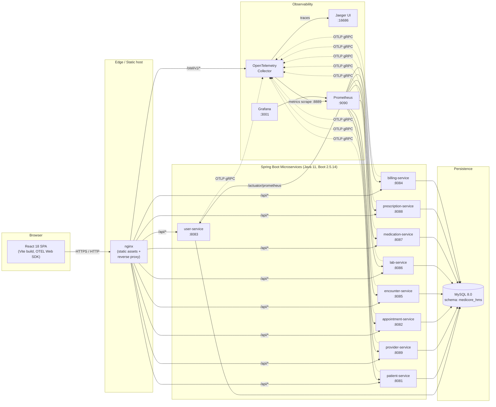
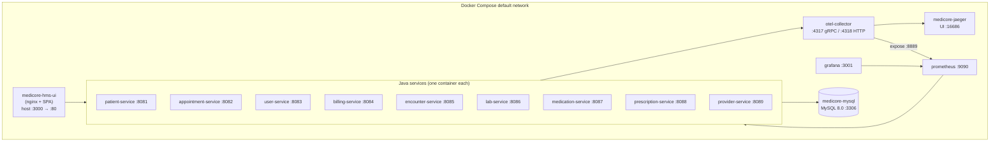
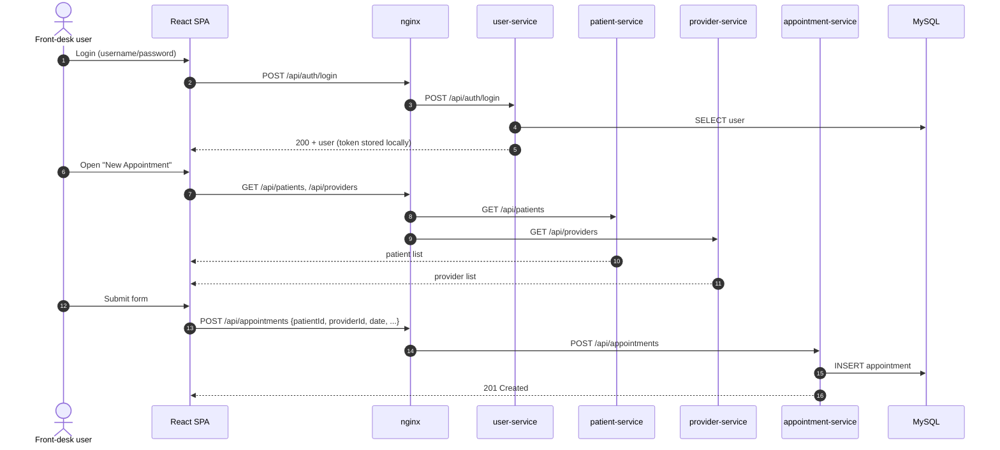
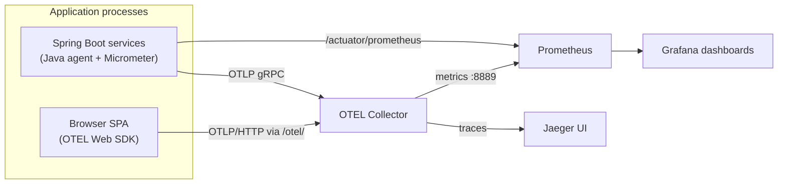

# MediCore HMS — High Level Design (HLD)

| | |
|---|---|
| **System** | MediCore Hospital Management System (HMS) |
| **Style** | Containerised microservices (Spring Boot + React SPA) |
| **Repository scope** | `legacy/java-microservices` — current "as‑is" baseline targeted for AWS modernisation |
| **Document type** | High Level Design (architecture, components, data, deployment, cross‑cutting concerns) |
| **Status** | Reverse‑engineered from source on the date of this commit |

---

## 1. Purpose & Scope

This document describes the **as‑is high level architecture** of the MediCore HMS reference application contained in this folder. The system is a small but realistic Hospital Management System used as a *legacy workload* in an AWS modernisation exercise. It demonstrates a classic Spring Boot microservices estate fronted by a React SPA, instrumented end‑to‑end with OpenTelemetry, and deployed locally via Docker Compose.

In scope:

- Logical decomposition of services
- Runtime / deployment topology (Docker Compose)
- Data model ownership and persistence
- Frontend ↔ backend integration
- Observability (traces, metrics, logs, dashboards)
- Build, packaging and configuration model

Out of scope: business requirements, detailed API contracts (low‑level design), production‑grade security hardening, target AWS architecture (handled separately by the modernisation track).

---

## 2. Architectural Drivers

| Driver | How it manifests in this design |
|---|---|
| **Service autonomy by domain** | Nine independent Spring Boot services, one per bounded context (patients, appointments, etc.) |
| **Polyglot UI / API separation** | React 18 SPA, fully decoupled, talks only to JSON REST APIs over `/api/*` |
| **Local dev parity with cloud** | Single `docker-compose.yml` brings the whole estate up; same images run in CI / sandbox |
| **Observability first** | Every service is OTEL‑instrumented (Java agent + SDK); frontend ships browser OTEL SDK; Jaeger + Prometheus + Grafana wired in by default |
| **Simplicity over premature scaling** | Shared MySQL schema, no service mesh, no message bus, no API gateway product — nginx acts as the edge router |

---

## 3. Logical Architecture

### 3.1 Component view

### 3.2 Service catalogue

| # | Service | Port | Bounded context / responsibility | Base path |
|---|---|---|---|---|
| 1 | `user-service` | 8083 | Users, roles, authentication (register / login) | `/api/users`, `/api/auth` |
| 2 | `patient-service` | 8081 | Patient demographics & records | `/api/patients` |
| 3 | `provider-service` | 8089 | Clinicians / providers directory | `/api/providers` |
| 4 | `appointment-service` | 8082 | Appointment scheduling | `/api/appointments` |
| 5 | `encounter-service` | 8085 | Clinical encounters / visits | `/api/encounters` |
| 6 | `lab-service` | 8086 | Lab orders & results | `/api/lab` (UI calls `/api/labs`) |
| 7 | `medication-service` | 8087 | Medication catalogue / inventory | `/api/medications` |
| 8 | `prescription-service` | 8088 | Prescriptions issued to patients | `/api/prescriptions` |
| 9 | `billing-service` | 8084 | Invoices / billing | `/api/invoices` |

> All services follow an identical internal layering: `controller` → `service` → `repository` → `model` (JPA entity), plus an `*Application.java` Spring Boot entry point.

### 3.3 Frontend modules

The React SPA (`frontend/`) mirrors the backend domains:

- Pages grouped per domain (`pages/patients`, `pages/appointments`, …) with **List / Form / View** screens per resource.
- One API client per domain (`src/api/patientApi.js`, …) built on a shared Axios instance (`apiClient.js`) — base URL relative, so nginx routing applies in all environments.
- `ServiceStatusPage` consumes the per‑service health endpoints exposed by nginx at `/health/<service>`.
- `telemetry.js` initialises the OpenTelemetry Web SDK and registers fetch / XHR / document‑load / user‑interaction instrumentations, exporting OTLP/HTTP to `/otel/v1/{traces,metrics}` (proxied to the collector).

---

## 4. Runtime / Deployment View

### 4.1 Topology (Docker Compose)

### 4.2 Container responsibilities

| Container | Image / build | Notes |
|---|---|---|
| `medicore-mysql` | `mysql:8.0` | Single schema `medicore_hms`; data persisted in named volume `mysql_data`; healthcheck via `mysqladmin ping` is required before services start |
| `*-service` (×9) | Built from each service `Dockerfile` (`eclipse-temurin:11-jre`) | Each pulls the OTEL Java agent at build time and starts with `-javaagent:opentelemetry-javaagent.jar`. Spring `depends_on` gates start on MySQL healthy state |
| `medicore-hms-ui` | Built from `frontend/Dockerfile` | nginx serves the Vite build and reverse‑proxies `/api/*`, `/health/*`, `/otel/*` |
| `otel-collector` | `otel/opentelemetry-collector:latest` | Receives OTLP gRPC :4317 / HTTP :4318; pipelines: traces → Jaeger, metrics → Prometheus exporter on :8889, logs → debug |
| `jaeger` | `jaegertracing/all-in-one:latest` | All‑in‑one trace store + UI |
| `prometheus` | `prom/prometheus:latest` | Scrapes `otel-collector:8889` and each service's `/actuator/prometheus` |
| `grafana` | `grafana/grafana:latest` | Auto‑provisioned datasource (Prometheus) and dashboards from `grafana/dashboards/` |

### 4.3 Environment‑driven configuration

Two YAML anchors in `docker-compose.yml` keep configuration DRY:

- `x-db-env` — `SPRING_DATASOURCE_URL/USERNAME/PASSWORD`, `SPRING_JPA_HIBERNATE_DDL_AUTO` (default `update`).
- `x-otel-env` — `OTEL_EXPORTER_OTLP_ENDPOINT`, `OTEL_{TRACES,METRICS,LOGS}_EXPORTER=otlp`, plus `SPRING_AUTOCONFIGURE_EXCLUDE` to disable the Spring Boot OTEL auto‑configuration in favour of the Java agent.

Each service additionally sets `OTEL_SERVICE_NAME` to its own name, which becomes the `service.name` resource attribute in all telemetry.

Spring defaults (`application.properties`) provide local‑development fallbacks for the same variables so a service can also be run outside Docker (`mvn spring-boot:run`).

---

## 5. Data Architecture

### 5.1 Persistence model

- **Single shared MySQL schema** (`medicore_hms`) shared by all nine services.
- Each service owns its own JPA entity / table set inside the shared schema and accesses *only* its own tables via Spring Data JPA repositories.
- Schema evolution is driven by Hibernate (`spring.jpa.hibernate.ddl-auto=update`) — convenient for the sandbox, but **not** a target practice for production.

> Trade‑off: shared schema simplifies the demo and removes cross‑service joins from the picture, at the cost of strong physical coupling. The modernisation track is expected to split this into per‑service datastores.

### 5.2 Domain entities (one per service)

| Service | Primary entity | Key foreign references (logical, not enforced) |
|---|---|---|
| user-service | `User` (username, password, role) | — |
| patient-service | `Patient` | — |
| provider-service | `Provider` | — |
| appointment-service | `Appointment` | `patientId`, `doctorId`/`providerId` |
| encounter-service | `Encounter` | `patientId`, `providerId`, `appointmentId` |
| lab-service | `LabOrder` (+ result) | `patientId`, `providerId`, `encounterId` |
| medication-service | `Medication` | — (catalogue) |
| prescription-service | `Prescription` | `patientId`, `providerId`, `medicationId` |
| billing-service | `Invoice` | `patientId`, `encounterId` |

Cross‑entity references are stored as plain `Long` IDs; **there are no inter‑service HTTP calls** in this baseline — the React UI orchestrates by issuing the necessary calls to each service through nginx.

### 5.3 Data flow — example: booking an appointment

---

## 6. API & Integration View

- **Style:** REST/JSON over HTTP, stateless per request.
- **Routing:** nginx (in the UI container) is the only edge component. It maps `/api/<resource>` to the appropriate service via Docker DNS service names (`patient-service:8081` etc.). The browser only ever sees same‑origin requests.
- **Auth model (baseline):**
  - `user-service` exposes `POST /api/auth/register` and `POST /api/auth/login`. Login returns the user record on success; the SPA stores a token in `localStorage` and the Axios client attaches it as `Authorization: Bearer …` on every request. A global 401 interceptor clears local state and redirects to `/login`.
  - Token issuance is intentionally minimal in this baseline (no JWT signing / verification on the server side). This is one of the items expected to be addressed by the modernisation track.
- **Inter‑service communication:** none directly. Composition happens in the SPA / via shared DB IDs.
- **Health & status:**
  - Each service exposes Spring Boot Actuator `/actuator/health` and `/actuator/prometheus`.
  - nginx proxies `/health/<service-name>` → `<service>/actuator/health` for the SPA's `ServiceStatusPage`.

---

## 7. Observability

The estate is wired for the full OpenTelemetry triad out of the box.

### 7.1 Traces

- **Backend:** each container runs with the OTEL Java agent (`opentelemetry-javaagent.jar`) plus the OTEL annotations dependency. Controllers add explicit `@WithSpan` / `@SpanAttribute` for business‑meaningful operations (e.g. `AppointmentController.createAppointment` with `appointment.id`).
- **Frontend:** `telemetry.js` registers fetch / XHR / document‑load / user‑interaction instrumentations and a W3C trace‑context propagator, so a click in the browser produces a span linked to the corresponding server‑side span.
- **Transport:** OTLP — gRPC (`:4317`) from backend, HTTP (`:4318`, via nginx `/otel/`) from browser.
- **Backend store:** Jaeger all‑in‑one (UI at `:16686`).

### 7.2 Metrics

- **Backend:** Micrometer + `micrometer-registry-prometheus` exposes `/actuator/prometheus` on each service. Prometheus scrapes them directly every 15 s (see `prometheus.yml`).
- **OTEL metrics path:** services also send OTLP metrics to the collector, which re‑exposes them on `:8889` for Prometheus.
- **Frontend:** custom counters / histogram (`ui.api.calls`, `ui.api.errors`, `ui.page.views`, `ui.api.latency_ms`) exported every 30 s via OTLP/HTTP.

### 7.3 Logs

- Backend services log via SLF4J + Logback (`logback-spring.xml`) and emit OTLP logs through the agent (collector pipeline currently exports to `debug`; production wiring would point it at a log backend).

### 7.4 Dashboards

Four Grafana dashboards are pre‑provisioned from `grafana/dashboards/`:

- `medicore-hms.json` — system overview
- `operational.json` — infra / runtime SLIs (latency, error rate, throughput)
- `functional.json` — per‑endpoint functional KPIs
- `business-metrics.json` — domain KPIs (appointments, prescriptions, …)

---

## 8. Build, Packaging & Configuration

| Aspect | Choice |
|---|---|
| JDK | Eclipse Temurin 11 (build & runtime) |
| Build tool | Maven (wrapper `mvnw` / `mvnw.cmd` per service) |
| Spring Boot | 2.5.14 (parent POM) |
| Web layer | `spring-boot-starter-web` (MVC, Tomcat) |
| Data layer | `spring-boot-starter-data-jpa` + `mysql-connector-java` |
| Metrics | `spring-boot-starter-actuator` + `micrometer-registry-prometheus` |
| Tracing | `opentelemetry-spring-boot-starter` + `opentelemetry-instrumentation-annotations` + Java agent at runtime |
| Container image | Per‑service `Dockerfile` based on `eclipse-temurin:11-jre`, COPYs `target/*.jar` |
| Frontend | React 18, React Router 6, Vite 5, Axios; built into static assets and served by nginx |
| Orchestration (local) | Docker Compose v3.8 (`docker-compose.yml`) |
| Helper scripts | `setup-sandbox.ps1` / `.sh`, `rebuild-all-services.ps1`, `copy-dashboards.ps1` |
| Integration tests | Node.js test suite under `integration-tests/` (`tests/00-health … 10-cross-service`) |

Configuration precedence per service: environment variable → `application.properties` default → Spring Boot default. The compose file is the canonical source of envs for the containerised topology.

---

## 9. Cross‑Cutting Concerns

### 9.1 Security (baseline — known gaps)

- HTTPS / TLS termination not configured (nginx serves plain HTTP).
- Auth is username/password against `user-service`; no JWT signing or per‑request server‑side validation.
- CORS is unrestricted; the SPA and APIs are served same‑origin via nginx, so it is not exercised in normal use.
- MySQL credentials supplied through env vars; suitable for dev only.
- Standard security headers (`X-Frame-Options`, `X-Content-Type-Options`, `X-XSS-Protection`) are set by nginx.

> These are deliberate baseline simplifications; the modernisation target should address them (managed identity / Cognito / IAM, TLS via ACM, secrets in Secrets Manager, etc.).

### 9.2 Resilience & availability

- `depends_on` with MySQL healthcheck ensures correct startup ordering.
- No retries / circuit breakers between services (there are no inter‑service calls).
- nginx `resolver 127.0.0.11 valid=10s` resolves upstreams per request, so a service can be restarted without restarting nginx.
- Single MySQL instance is a single point of failure in this baseline.

### 9.3 Scalability

- Each Spring Boot service is stateless ⇒ horizontally scalable behind a load balancer.
- Database is the obvious bottleneck (shared schema, single node).
- Frontend is a static bundle and trivially CDN‑cacheable.

### 9.4 Maintainability

- Strict one‑pattern‑per‑service layering across all nine backends keeps cognitive load low.
- Per‑service API client + per‑domain page tree on the frontend mirrors the backend layout.
- Compose anchors (`x-db-env`, `x-otel-env`) avoid configuration drift.

---

## 10. Network & Port Map (Reference)

| Component | Container port | Host port | Notes |
|---|---|---|---|
| medicore-hms-ui (nginx) | 80 | **3000** | SPA + reverse proxy |
| mysql | 3306 | 3306 | Dev convenience; remove in shared environments |
| patient-service | 8081 | 8081 | |
| appointment-service | 8082 | 8082 | |
| user-service | 8083 | 8083 | |
| billing-service | 8084 | 8084 | |
| encounter-service | 8085 | 8085 | |
| lab-service | 8086 | 8086 | |
| medication-service | 8087 | 8087 | |
| prescription-service | 8088 | 8088 | |
| provider-service | 8089 | 8089 | |
| otel-collector | 4317 / 4318 | 4317 / 4318 | OTLP gRPC / HTTP |
| jaeger | 16686 / 14250 / 14268 | same | UI / gRPC / HTTP collectors |
| prometheus | 9090 | 9090 | |
| grafana | 3000 | **3001** | UI |

---

## 11. Known Limitations & Improvement Backlog

| # | Item | Suggested direction |
|---|---|---|
| 1 | Java 11 / Spring Boot 2.5.14 are out of support | Upgrade to Java 17/21 and Spring Boot 3.x (a `modernize-java` agent is available in this repo) |
| 2 | Shared MySQL schema | Database‑per‑service; introduce events / outbox for cross‑service data needs |
| 3 | No real authentication / authorization | JWT or OIDC (Cognito) at the edge; per‑service authorization filters |
| 4 | No API gateway | Replace bare nginx with API Gateway / ALB + Cognito authorizer in AWS target |
| 5 | `ddl-auto=update` | Adopt Flyway or Liquibase migrations |
| 6 | Single‑node infra components | Managed services in AWS (RDS, Managed Prometheus / Grafana, OpenSearch, X‑Ray or ADOT) |
| 7 | Logs exported only to `debug` exporter | Route OTLP logs to a real backend (CloudWatch / Loki / OpenSearch) |
| 8 | No CI pipeline defined here | Add multi‑module CI (build, test, scan, image push) per service |

---

## 12. Glossary

- **HMS** — Hospital Management System.
- **SPA** — Single‑Page Application (React + Vite build).
- **OTLP** — OpenTelemetry Protocol (gRPC on 4317, HTTP on 4318).
- **Actuator** — Spring Boot management/observability endpoints (`/actuator/health`, `/actuator/prometheus`).
- **Bounded context** — DDD term: an explicit boundary within which a particular domain model is defined and applicable; each microservice owns one.

---