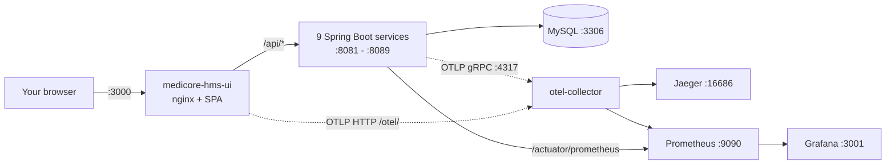
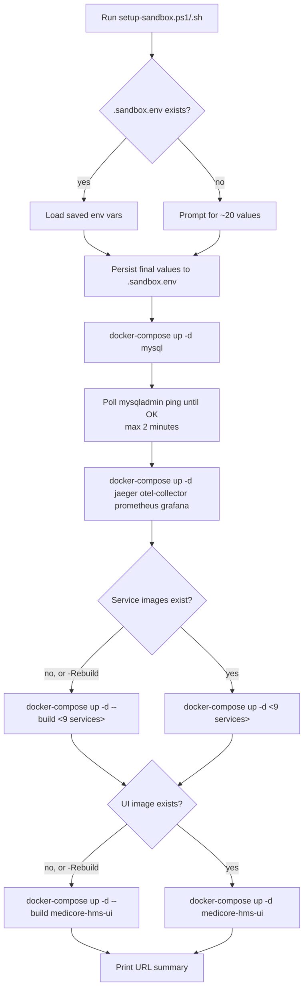

# MediCore HMS — Local Sandbox Setup Guide

| | |
|---|---|
| **Audience** | Developers running the full stack on a workstation for the first time |
| **Companions** | [HIGH-LEVEL-DESIGN.md](HIGH-LEVEL-DESIGN.md), [LOW-LEVEL-DESIGN.md](LOW-LEVEL-DESIGN.md) |
| **Outcome** | A fully working sandbox: 9 Spring Boot services + MySQL + React UI + Jaeger + Prometheus + Grafana, all in Docker, browsable from `http://localhost:3000` |

---

## 1. What You Are Standing Up

A single Docker Compose application made of **14 containers**:

| Group | Containers |
|---|---|
| Frontend | `medicore-hms-ui` (nginx + React SPA) |
| Backend services (9) | `patient-service`, `appointment-service`, `user-service`, `billing-service`, `encounter-service`, `lab-service`, `medication-service`, `prescription-service`, `provider-service` |
| Data | `medicore-mysql` (MySQL 8) |
| Observability | `otel-collector`, `medicore-jaeger`, `prometheus`, `grafana` |



---

## 2. Prerequisites

| Tool | Minimum version | Why | Verify with |
|---|---|---|---|
| **Docker Engine / Docker Desktop** | 20.10+ | Runs every container | `docker --version` |
| **Docker Compose v1 plugin** | 1.29+ (or v2 invoked as `docker-compose`) | Compose file uses v3.8 syntax and the scripts call `docker-compose` (with the hyphen) | `docker-compose --version` |
| **PowerShell** (Windows) | 5.1+ or PowerShell 7+ | To run `setup-sandbox.ps1` | `$PSVersionTable.PSVersion` |
| **Bash** (macOS / Linux / WSL) | any modern | To run `setup-sandbox.sh` | `bash --version` |
| **Git** | any | To clone the repo | `git --version` |
| **JDK 11** *(optional)* | Temurin 11 | Only if you plan to rebuild service JARs locally | `java -version` |
| **Maven wrapper** | bundled | Each service ships `mvnw` / `mvnw.cmd`; no global Maven required | — |
| **Node.js** *(optional)* | 18+ | Only for running the integration test suite | `node --version` |

### 2.1 System resources

Empirical minimum to run the full sandbox comfortably:

- **CPU:** 4 cores
- **RAM:** 8 GB free for Docker (Docker Desktop → Settings → Resources)
- **Disk:** ~6 GB (images + MySQL volume + Maven local repo if you build locally)

### 2.2 Free ports

Default published ports — adjust via env vars (see §5) if any clash.

| Port(s) | Owner | Required? |
|---|---|---|
| `3000` | Frontend (nginx) | yes |
| `3001` | Grafana | yes |
| `3306` | MySQL | yes |
| `4317`, `4318` | OTEL Collector (gRPC, HTTP) | yes |
| `9090` | Prometheus | yes |
| `14250`, `14268`, `16686` | Jaeger (gRPC, HTTP, UI) | yes |
| `8081` – `8089` | One per backend service | yes |

Quick port‑in‑use check:

```powershell
# PowerShell
3000,3001,3306,4317,4318,8081..8089,9090,16686 |
    ForEach-Object { Get-NetTCPConnection -LocalPort $_ -ErrorAction SilentlyContinue }
```

```bash
# bash
for p in 3000 3001 3306 4317 4318 9090 16686 8081 8082 8083 8084 8085 8086 8087 8088 8089; do
  (ss -ltn "( sport = :$p )" | grep -q LISTEN) && echo "PORT $p in use"
done
```

---

## 3. The Five‑Minute Path

If you accept all defaults and Docker is already running:

### Windows (PowerShell)

```powershell
cd "<repo>\legacy\java-microservices"
.\setup-sandbox.ps1
```

### macOS / Linux

```bash
cd <repo>/legacy/java-microservices
chmod +x setup-sandbox.sh
./setup-sandbox.sh
```

You will be prompted for ~20 settings (DB password, ports, Grafana password, OTEL options). Hit **Enter** at every prompt to accept the default. The script will:

1. Save your answers to `.sandbox.env` so re‑runs skip the prompts.
2. Start MySQL and wait until `mysqladmin ping` succeeds.
3. Start the observability stack (Jaeger, OTEL Collector, Prometheus, Grafana).
4. Build (first run only) and start all 9 Java services.
5. Build (first run only) and start the frontend.
6. Print a summary of every URL.

When it finishes, open <http://localhost:3000>.

> First run takes **5–15 min** depending on network speed (Maven + Docker image pulls). Subsequent runs start in seconds because images are cached and `.sandbox.env` skips prompts.

---

## 4. What the Setup Script Actually Does



### 4.1 Flags

| Flag | What it does |
|---|---|
| *(none)* | Normal startup. Reuses `.sandbox.env` if present. |
| `-Teardown` (PowerShell only) | Stops and removes **all** Docker containers on the host (be careful — it isn't limited to this project). |
| `-Rebuild` (PowerShell only) | Forces `docker-compose build` for the services and UI even when images already exist. Use after pulling new code. |

The bash script does not implement `-Teardown` / `-Rebuild`. The equivalent commands are shown in §8.

### 4.2 Where the JARs come from

The Java service Dockerfiles do **not** run Maven. They only `COPY target/*.jar app.jar`. There are two scenarios:

| Scenario | What happens |
|---|---|
| You have already run `mvn package` (or `rebuild-all-services.ps1`) and `target/*.jar` exists in each service | `docker-compose build` packages those JARs into images. |
| You cloned fresh and `target/` is empty | The build fails because no JAR is found. You must run the Maven build first (see §6.2). |

> The repo currently ships pre‑built `target/*.jar.original` files but **not** the runnable `*.jar`. Most first‑time clones therefore need a one‑off Maven build before `docker-compose build` will succeed. The `setup-sandbox` script does not detect this — if `docker-compose build` fails complaining about no JAR found, run `rebuild-all-services.ps1` first.

---

## 5. Configuration Reference

All values are environment variables. They are prompted by the setup script (defaults shown) and persisted to `.sandbox.env` after the first successful run.

### 5.1 Database

| Env var | Default | Notes |
|---|---|---|
| `MYSQL_DATABASE` | `medicore_hms` | All 9 services share this schema |
| `SPRING_DATASOURCE_USERNAME` | `medicore` | App user |
| `SPRING_DATASOURCE_PASSWORD` | `medicore_pass` | App password (prompted hidden) |
| `MYSQL_ROOT_PASSWORD` | `root_pass` | Root password (prompted hidden) |
| `MYSQL_PORT` | `3306` | Host‑side publish port |

### 5.2 Service ports

| Env var | Default |
|---|---|
| `PATIENT_SERVICE_PORT` | `8081` |
| `APPOINTMENT_SERVICE_PORT` | `8082` |
| `USER_SERVICE_PORT` | `8083` |
| `BILLING_SERVICE_PORT` | `8084` |
| `ENCOUNTER_SERVICE_PORT` | `8085` |
| `LAB_SERVICE_PORT` | `8086` |
| `MEDICATION_SERVICE_PORT` | `8087` |
| `PRESCRIPTION_SERVICE_PORT` | `8088` |
| `PROVIDER_SERVICE_PORT` | `8089` |

> Note: `docker-compose.yml` hard‑codes `8081..8089` in the `ports:` mappings. Changing these env vars alone is **not currently honoured** by the compose file — you also have to update the published port. This is one of the LLD findings tracked in the design docs.

### 5.3 UI and observability ports

| Env var | Default |
|---|---|
| `FRONTEND_PORT` | `3000` |
| `GRAFANA_PORT` | `3001` |
| `PROMETHEUS_PORT` | `9090` |
| `JAEGER_UI_PORT` | `16686` |
| `GRAFANA_ADMIN_PASSWORD` | `admin` (prompted hidden) |

### 5.4 OpenTelemetry

| Env var | Default | Notes |
|---|---|---|
| `OTEL_EXPORTER_OTLP_ENDPOINT` | `http://otel-collector:4317` | Always use the compose service name from inside containers |
| `OTEL_TRACES_EXPORTER` | `otlp` | `none` to disable traces |
| `OTEL_METRICS_EXPORTER` | `otlp` | `none` to disable OTLP metrics (Micrometer scrape still works) |
| `OTEL_LOGS_EXPORTER` | `otlp` | `none` to disable log export |

### 5.5 Pre‑seeding to skip the prompts

PowerShell:

```powershell
$env:SPRING_DATASOURCE_PASSWORD = "supersecret"
$env:GRAFANA_ADMIN_PASSWORD     = "grafana123"
.\setup-sandbox.ps1
```

Bash:

```bash
export SPRING_DATASOURCE_PASSWORD=supersecret
export GRAFANA_ADMIN_PASSWORD=grafana123
./setup-sandbox.sh
```

Or simply edit `.sandbox.env` after the first run.

---

## 6. Alternative / Manual Workflows

### 6.1 Pure `docker-compose` (no helper script)

If you don't care about the interactive prompts:

```bash
docker-compose up -d --build
```

Defaults baked into `docker-compose.yml` (`medicore` / `medicore_pass`, etc.) will be used. The same caveat about pre‑built JARs from §4.2 applies.

### 6.2 Building only the Java code

Run the per‑service Maven build first, then let compose copy the JARs into the images:

**Windows (one shot, all services + image rebuild + restart):**

```powershell
.\rebuild-all-services.ps1
```

This:

1. Confirms with you (Y/N).
2. Runs `mvn clean package -DskipTests` in each of the 9 service directories.
3. Runs `docker-compose build`.
4. Runs `docker-compose down` then `up -d`.
5. Waits 60 s, then probes `/actuator/health` on every service and prints a `healthy / 9` summary.

**Manually, per service:**

```bash
cd patient-service
./mvnw clean package -DskipTests        # macOS / Linux / WSL
.\mvnw.cmd clean package -DskipTests    # PowerShell
cd ..
docker-compose build patient-service
docker-compose up -d patient-service
```

### 6.3 Running a service outside Docker (debugging)

Each service has a sensible local default in `application.properties`:

- Datasource: `jdbc:mysql://localhost:3306/medicore_hms`
- OTLP endpoint: `http://localhost:4317`

So you can keep `mysql` + `otel-collector` running in Docker (`docker-compose up -d mysql otel-collector jaeger`) and launch a single service from your IDE or via:

```bash
cd patient-service
./mvnw spring-boot:run
```

The other 8 services can keep running in containers; nginx will continue routing to whichever instance is bound to the published port.

### 6.4 Running just the UI from Vite dev server

Useful for fast frontend iteration:

```bash
cd frontend
npm install
npm run dev
```

Vite serves on `http://localhost:3000` with a proxy: `/api` → `VITE_API_BASE_URL` (default `http://localhost:8080`). To talk to a backend service directly, set:

```bash
# bash
VITE_API_BASE_URL=http://localhost:8081 npm run dev
```

For full multi‑service routing the recommended path is to keep the nginx container up (it does the per‑service fan‑out) and only swap in your Vite dev assets when needed.

---

## 7. Verifying the Sandbox

### 7.1 Container health

```bash
docker-compose ps
```

All 14 containers should be `Up` (and `healthy` for those that declare a healthcheck — `medicore-mysql` and `medicore-hms-ui`).

### 7.2 Per‑service health endpoints

```powershell
8081..8089 | ForEach-Object {
    $u = "http://localhost:$_/actuator/health"
    try { "$u  $(Invoke-RestMethod $u | ConvertTo-Json -Compress)" }
    catch { "$u  DOWN" }
}
```

```bash
for p in 8081 8082 8083 8084 8085 8086 8087 8088 8089; do
  curl -s -o /dev/null -w "%{http_code}  http://localhost:$p/actuator/health\n" \
       http://localhost:$p/actuator/health
done
```

A `200` with `{"status":"UP"}` is the expected response.

### 7.3 In‑app health dashboard

In the UI, sign in (register a user first — see §7.5) and navigate to **Service Status** (`/status`). The page calls `/health/<service>` for every backend and shows latency / DB / disk health.

### 7.4 Trace propagation

Open <http://localhost:16686> (Jaeger). Pick `medicore-hms-ui` as the service, click **Find Traces**, then drill into any trace — you should see spans from the browser through nginx into one or more backend services and JDBC, all stitched together via the `traceparent` header.

### 7.5 First user (sandbox has no seed data)

```bash
curl -X POST http://localhost:3000/api/auth/register \
     -H "Content-Type: application/json" \
     -d '{"username":"admin","password":"admin123","role":"ADMIN"}'
```

Then log in at <http://localhost:3000/login> with `admin` / `admin123`.

### 7.6 Running the integration tests

```powershell
cd integration-tests
npm install                         # only the first time
.\run-tests.ps1 -WaitForServices
```

```bash
cd integration-tests
npm install
npm test
```

Available suites: `health, users, providers, patients, appointments, encounters, lab, medications, prescriptions, billing, cross`. Run a subset with `.\run-tests.ps1 -Suites health,cross` or `npm run test:health`.

---

## 8. Day‑to‑Day Operations

### 8.1 Stop the sandbox

```bash
docker-compose stop          # graceful, preserves containers + volumes
```

### 8.2 Stop and remove containers (keep DB data)

```bash
docker-compose down          # removes containers; mysql_data volume survives
```

### 8.3 Start back up

```bash
docker-compose up -d
# or, to also reload your .sandbox.env values:
.\setup-sandbox.ps1
```

### 8.4 Wipe the database

```bash
docker-compose down -v       # also removes named volumes (mysql_data)
```

> After this, the next start re‑creates an empty schema via Hibernate (`ddl-auto=update`). All users, patients, appointments etc. are gone.

### 8.5 Rebuild after a code change

| Change | Command |
|---|---|
| Single service | `cd <service> && ./mvnw clean package -DskipTests && cd .. && docker-compose up -d --build <service>` |
| All services | `.\rebuild-all-services.ps1` |
| Only the frontend | `docker-compose up -d --build medicore-hms-ui` |

### 8.6 Tail logs

```bash
docker-compose logs -f patient-service appointment-service
docker-compose logs -f medicore-hms-ui
```

### 8.7 Update Grafana dashboards from the repo

After editing a dashboard JSON in `grafana/dashboards/`:

```powershell
.\copy-dashboards.ps1
```

This copies the four JSONs into the provisioning folder consumed by the running Grafana container and restarts Grafana. Dashboards are re‑imported within ~20 s.

### 8.8 Open a MySQL shell

```bash
docker-compose exec mysql mysql -u medicore -p medicore_hms
# password = SPRING_DATASOURCE_PASSWORD
```

---

## 9. Access URLs (Cheat Sheet)

| Surface | URL | Credentials |
|---|---|---|
| MediCore HMS UI | <http://localhost:3000> | The user you register |
| Grafana | <http://localhost:3001> | `admin` / `GRAFANA_ADMIN_PASSWORD` |
| Prometheus | <http://localhost:9090> | — |
| Jaeger UI | <http://localhost:16686> | — |
| MySQL | `localhost:3306` | `medicore` / `SPRING_DATASOURCE_PASSWORD` |
| Service status page | <http://localhost:3000/status> | Logged‑in user |
| Per‑service health | <http://localhost:8081/actuator/health> … <http://localhost:8089/actuator/health> | — |
| Per‑service Prometheus | <http://localhost:8081/actuator/prometheus> … <http://localhost:8089/actuator/prometheus> | — |
| OTEL Collector (OTLP) | gRPC `:4317`, HTTP `:4318` | — |

---

## 10. Troubleshooting

| Symptom | Likely cause | Fix |
|---|---|---|
| `docker-compose build` fails with `COPY target/*.jar: no source files were found` | Service JARs not built yet | Run `rebuild-all-services.ps1` (or `mvn package` per service) first |
| Setup script hangs on "Waiting for MySQL" | Wrong DB password in `.sandbox.env` after you changed it, or another MySQL using port 3306 | Delete `.sandbox.env`; stop the host MySQL; re‑run the script |
| A backend container restarts in a loop | Misconfigured datasource or invalid DDL | `docker-compose logs <service>`; check `application.properties` override env vars; consider `docker-compose down -v` to reset the schema |
| `Service Status` page shows everything `DOWN` from inside the UI | nginx can't resolve the service names | Make sure all 9 service containers are `Up` (`docker-compose ps`); restart `medicore-hms-ui` to refresh DNS cache |
| Jaeger UI shows no traces | Services started before `otel-collector` was ready | `docker-compose restart <service>`; refresh and emit a request from the UI |
| Prometheus targets show some services as `DOWN` | `prometheus.yml` has the historical port mapping that doesn't match compose (known issue) | Edit `prometheus.yml` so each `targets:` line matches the real `*_SERVICE_PORT`, then `docker-compose restart prometheus` |
| `/api/auth/login` returns `401` for a user you just created | Wrong password, or you registered against a different running `user-service` | Re‑register; check that only one user-service container is bound to `8083` |
| Browser shows blank page or 404 on routes like `/patients` | nginx SPA fallback is fine; usually a missing build asset | Rebuild the frontend: `docker-compose up -d --build medicore-hms-ui` |
| Port already in use | Another local process owns the port | Override the env var (e.g. `FRONTEND_PORT=4000`) and update the corresponding `ports:` line in `docker-compose.yml`, or stop the conflicting process |
| Mac/Linux: `permission denied` on `setup-sandbox.sh` | Missing execute bit | `chmod +x setup-sandbox.sh` |
| Windows: PowerShell refuses to run the script | Execution policy | `Set-ExecutionPolicy -Scope Process -ExecutionPolicy RemoteSigned` for the current session |

---

## 11. Full Teardown

To remove everything created by the sandbox (containers, network, volumes, *not* images):

```bash
docker-compose down -v --remove-orphans
del .sandbox.env       # PowerShell
rm  .sandbox.env       # bash
```

To also remove the images built from this project:

```bash
docker images --format "{{.Repository}}:{{.Tag}}" |
    grep "^java-microservices-" |
    xargs -r docker rmi
```

PowerShell:

```powershell
docker images --format "{{.Repository}}:{{.Tag}}" |
    Where-Object { $_ -like "java-microservices-*" } |
    ForEach-Object { docker rmi $_ }
```

The `-Teardown` switch on `setup-sandbox.ps1` is more aggressive — it stops and removes *every* container on the host. Prefer the explicit `docker-compose down -v` above for a clean, project‑scoped wipe.

---

## 12. Next Steps

- Read the [HIGH-LEVEL-DESIGN.md](HIGH-LEVEL-DESIGN.md) to understand the architecture.
- Read the [LOW-LEVEL-DESIGN.md](LOW-LEVEL-DESIGN.md) for entity, repository, controller and frontend details.
- Explore the [Grafana dashboards](grafana/dashboards/README.md) once you have generated some traffic via the UI or the integration tests.
- When ready to upgrade Java / Spring Boot, invoke the `modernize-java` agent registered in this workspace.

---
