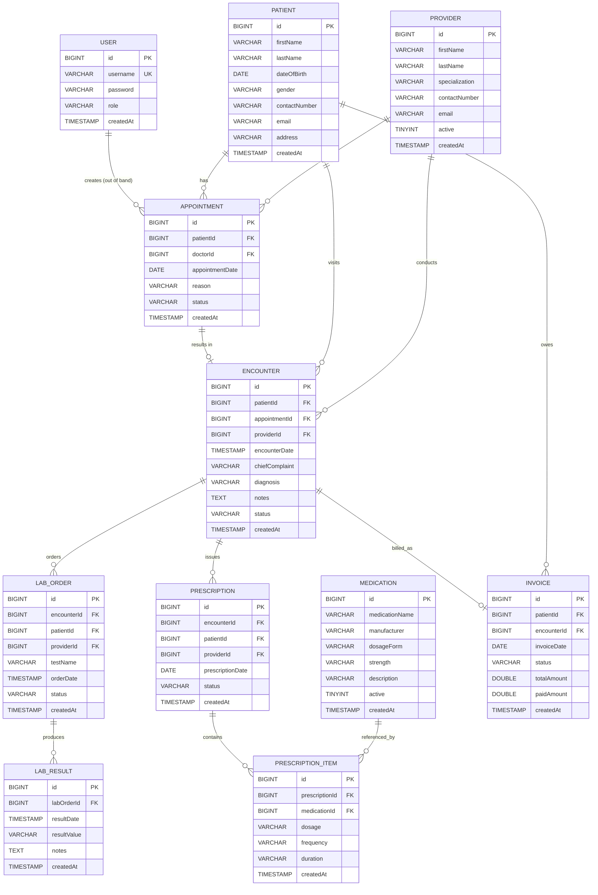
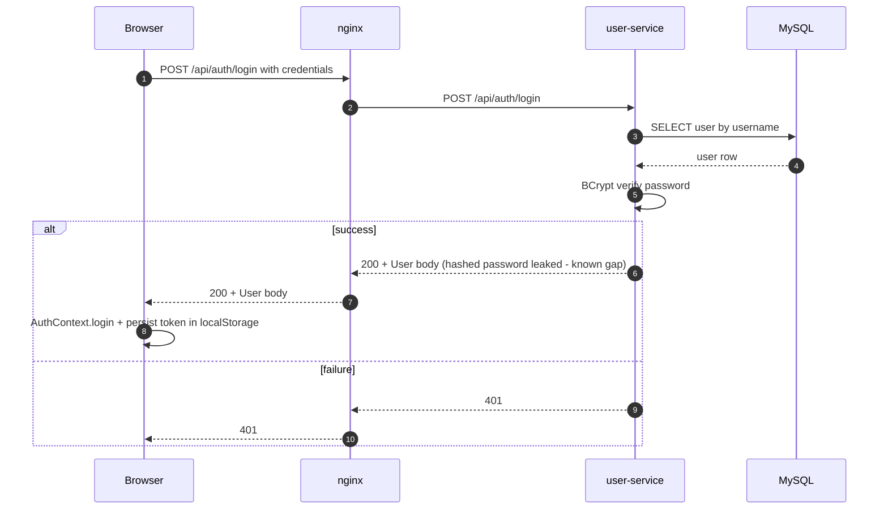
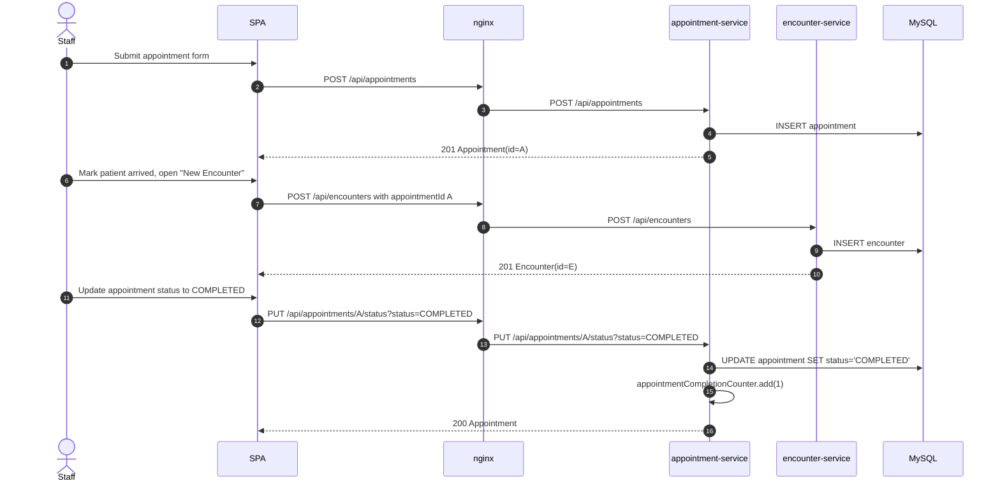
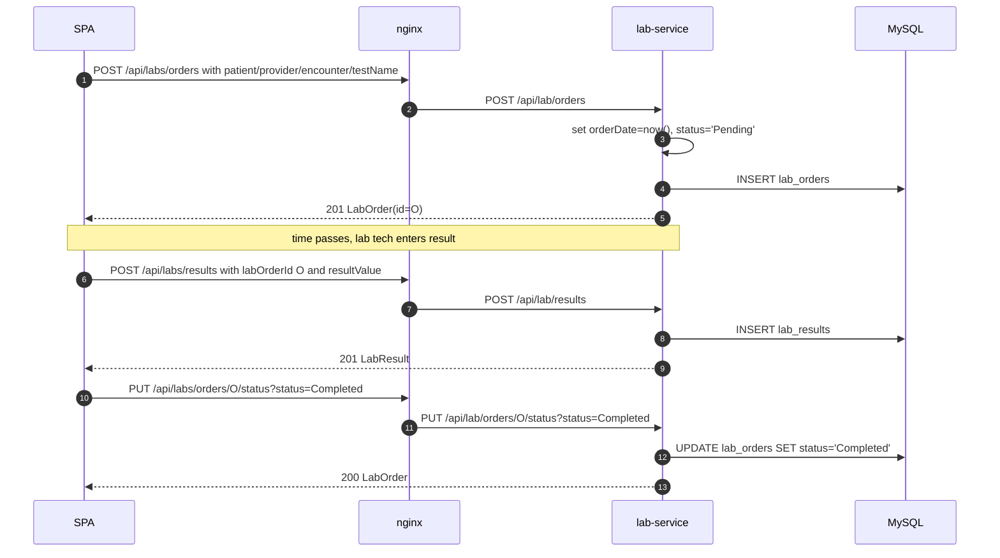

# MediCore HMS — Low Level Design (LLD)

| | |
|---|---|
| **System** | MediCore Hospital Management System (HMS) |
| **Companion to** | [HIGH-LEVEL-DESIGN.md](HIGH-LEVEL-DESIGN.md) |
| **Audience** | Developers, modernisation engineers, code reviewers |
| **Document type** | Low Level Design (entities, repositories, services, endpoints, configs, frontend internals) |
| **Status** | Reverse‑engineered from source on the date of this commit |

---

## 1. How to Read This Document

The HLD describes *what* the system is. This LLD describes *how it is built*, file by file:

- A **per‑service section** for each of the 9 Spring Boot services, with: layered class catalogue, entity field tables, repository method signatures, service method signatures, REST endpoint tables, observability hooks, and the canonical `application.properties`.
- A **frontend section** covering the Axios client, per‑domain API modules, routing, contexts and shared components.
- An **integration tests** and **operational scripts** section.
- Cross‑cutting reference tables: full endpoint inventory, full metric inventory, sequence diagrams for the most important flows.

Conventions used throughout:

- All services share the package root `com.medicore.hms.<domain>`.
- All services follow the same 5‑class skeleton: `*Application` → `controller/` → `service/` → `repository/` → `model/`.
- `@WithSpan` / `@SpanAttribute` annotations are present on every controller method and the business methods of every service (referred to below as "fully traced"); annotation noise is omitted from method signatures for readability.
- All entities use `@Id @GeneratedValue(strategy = GenerationType.IDENTITY)` for `Long id`, and a `@Temporal(TIMESTAMP) @Column(nullable = false, updatable = false) Date createdAt` populated by `@PrePersist`.
- All services share the same `application.properties` template — only `spring.application.name`, `server.port` and `otel.service.name` differ. The full template is shown once in §4.1 and only the deltas are repeated thereafter.

---

## 2. Cross‑Cutting Reference

### 2.1 Service port & path map

| Service | Spring port | UI nginx route | Controller base path |
|---|---|---|---|
| `patient-service` | 8081 | `/api/patients` | `/api/patients` |
| `appointment-service` | 8082 | `/api/appointments` | `/api/appointments` |
| `user-service` | 8083 | `/api/users`, `/api/auth` | `/api/users`, `/api/auth` |
| `billing-service` | 8084 | `/api/invoices` | `/api/invoices` |
| `encounter-service` | 8085 | `/api/encounters` | `/api/encounters` |
| `lab-service` | 8086 | `/api/labs` *(client)* → `/api/lab` *(server)* | `/api/lab` |
| `medication-service` | 8087 | `/api/medications` | `/api/medications` |
| `prescription-service` | 8088 | `/api/prescriptions` | `/api/prescriptions` |
| `provider-service` | 8089 | `/api/providers` | `/api/providers` |

> The frontend `labApi.js` calls `/api/labs` (plural), which nginx routes to `lab-service`; the server itself is `/api/lab`. Keep this in mind when wiring new endpoints.

### 2.2 Standard error mapping

Every controller follows the same `try / catch` shape:

| Situation | HTTP status |
|---|---|
| Successful create | `201 CREATED` (entity body) |
| Successful read | `200 OK` (entity or list body) |
| Successful delete | `204 NO CONTENT` |
| Resource not found by id | `404 NOT FOUND` |
| Validation error (auth only) | `400 BAD REQUEST` |
| Username conflict (auth/users) | `409 CONFLICT` |
| Login failure | `401 UNAUTHORIZED` |
| Any other exception | `500 INTERNAL SERVER ERROR` |

There is **no global `@ControllerAdvice`** — each controller method does its own logging and `ResponseEntity` building. This is intentional in the baseline; it is a known LLD smell to be addressed during modernisation.

### 2.3 Standard `application.properties` template

Identical for every service except for the three lines marked `// per-service`:

```properties
spring.application.name=<service>           # per-service
server.port=<port>                          # per-service

spring.datasource.url=${SPRING_DATASOURCE_URL:jdbc:mysql://localhost:3306/medicore_hms?useSSL=false&allowPublicKeyRetrieval=true&serverTimezone=UTC}
spring.datasource.username=${SPRING_DATASOURCE_USERNAME:medicore}
spring.datasource.password=${SPRING_DATASOURCE_PASSWORD:medicore_pass}
spring.jpa.hibernate.ddl-auto=${SPRING_JPA_HIBERNATE_DDL_AUTO:update}
spring.jpa.properties.hibernate.dialect=org.hibernate.dialect.MySQL8Dialect

otel.exporter.otlp.endpoint=${OTEL_EXPORTER_OTLP_ENDPOINT:http://localhost:4317}
otel.traces.exporter=${OTEL_TRACES_EXPORTER:otlp}
otel.metrics.exporter=${OTEL_METRICS_EXPORTER:otlp}
otel.logs.exporter=${OTEL_LOGS_EXPORTER:otlp}
otel.service.name=<service>                 # per-service

management.endpoints.web.exposure.include=health,info,prometheus
management.endpoint.prometheus.enabled=true
management.metrics.export.prometheus.enabled=true
```

### 2.4 Standard `Dockerfile` template

Every Java service Dockerfile is identical except for the `EXPOSE` port:

```dockerfile
FROM eclipse-temurin:11-jre
WORKDIR /app
ADD https://github.com/open-telemetry/opentelemetry-java-instrumentation/releases/download/v1.33.6/opentelemetry-javaagent.jar /app/opentelemetry-javaagent.jar
COPY target/*.jar app.jar
EXPOSE <port>
ENTRYPOINT ["java","-javaagent:/app/opentelemetry-javaagent.jar","-jar","app.jar"]
```

> Implication: the build is **two‑step** — `mvn package` first (locally or via `rebuild-all-services.ps1`), then `docker-compose build`. The Dockerfile does *not* itself run Maven.

### 2.5 Standard `pom.xml` skeleton

Each service uses the same parent and dependency set:

| Dependency | Version / source |
|---|---|
| `spring-boot-starter-parent` (parent) | 2.5.14 |
| `spring-boot-starter-web` | inherited |
| `spring-boot-starter-data-jpa` | inherited |
| `spring-boot-starter-actuator` | inherited |
| `mysql-connector-java` | inherited, runtime scope |
| `io.opentelemetry:opentelemetry-api / sdk / exporter-otlp` | 1.39.0 |
| `io.opentelemetry.instrumentation:opentelemetry-spring-boot-starter` | 1.33.6‑alpha |
| `io.opentelemetry.instrumentation:opentelemetry-instrumentation-annotations` | 1.33.6 |
| `io.micrometer:micrometer-registry-prometheus` | inherited |
| `spring-boot-starter-test` | inherited, test scope |

Java target: **11**. Build plugin: `spring-boot-maven-plugin`.

---

## 3. Domain Data Model

### 3.1 Conceptual ER diagram

The diagram below is **conceptual**: foreign keys are stored as plain `Long` columns (not JPA relationships), and the schema is shared by all services.



> **Note:** `Appointment.doctorId` is exposed via getter/setter aliases `getProviderId()/setProviderId()` for API compatibility. `Provider.specialization` is exposed via getter/setter aliases `getSpeciality()/setSpeciality()`.

---

## 4. Per‑Service LLD

### 4.1 `patient-service` (:8081)

**Package root:** `com.medicore.hms.patient`  
**Class catalogue:** `PatientServiceApplication`, `controller/PatientController`, `service/PatientService`, `repository/PatientRepository`, `model/Patient`.

#### 4.1.1 Entity — `Patient` (`patient`)

| Field | Java type | Notes |
|---|---|---|
| `id` | `Long` | PK, identity |
| `firstName` | `String` | |
| `lastName` | `String` | |
| `dateOfBirth` | `Date` | |
| `gender` | `String` | |
| `contactNumber` | `String` | |
| `email` | `String` | |
| `address` | `String` | |
| `createdAt` | `Date` | timestamp, set in `@PrePersist` |

#### 4.1.2 Repository — `PatientRepository extends JpaRepository<Patient, Long>`

- `List<Patient> findByFirstNameContainingIgnoreCaseOrLastNameContainingIgnoreCase(String firstName, String lastName)`

#### 4.1.3 Service — `PatientService`

| Method | Purpose |
|---|---|
| `Patient createPatient(Patient p)` | Persist; increment `medicore.patient.registrations.total` |
| `Optional<Patient> getPatientById(Long id)` | Lookup |
| `List<Patient> getAllPatients()` | Lookup all |
| `Patient updatePatient(Patient p)` | Save; increment `medicore.patient.updates.total` |
| `List<Patient> searchPatients(String query)` | Wildcard name search; increment `medicore.patient.searches.total` |
| `void deletePatient(Long id)` | Delete |

Metrics also exposes gauge `medicore.patient.active.count` bound to `repository.count()`.

#### 4.1.4 Controller — `PatientController` (`/api/patients`)

| Method | Path | Body / params | Returns |
|---|---|---|---|
| POST | `/api/patients` | `Patient` body | `201 Patient` |
| GET | `/api/patients` | — | `200 List<Patient>` |
| GET | `/api/patients/{id}` | path `id` | `200 Patient` / `404` |
| GET | `/api/patients/search` | query `query` | `200 List<Patient>` |
| PUT | `/api/patients/{id}` | path `id`, `Patient` body | `200 Patient` |
| DELETE | `/api/patients/{id}` | path `id` | `204` |

#### 4.1.5 `application.properties` delta

`spring.application.name=patient-service`, `server.port=8081`, `otel.service.name=patient-service`.

---

### 4.2 `appointment-service` (:8082)

**Package root:** `com.medicore.hms.appointment`.

#### 4.2.1 Entity — `Appointment` (`appointment`)

| Field | Java type | Notes |
|---|---|---|
| `id` | `Long` | PK, identity |
| `patientId` | `Long` | FK (logical) → `patient.id` |
| `doctorId` | `Long` | FK (logical) → `provider.id`; exposed as `providerId` via aliasing accessors |
| `appointmentDate` | `Date` | |
| `reason` | `String` | |
| `status` | `String` | e.g. `SCHEDULED`, `CANCELLED`, `COMPLETED` |
| `createdAt` | `Date` | timestamp |

#### 4.2.2 Repository — `AppointmentRepository`

- `List<Appointment> findByPatientId(Long patientId)`
- `List<Appointment> findByDoctorId(Long doctorId)`

#### 4.2.3 Service — `AppointmentService`

| Method | Purpose |
|---|---|
| `Appointment createAppointment(Appointment a)` | Persist; increment `medicore.appointment.bookings.total` |
| `Optional<Appointment> getAppointmentById(Long id)` | Lookup |
| `List<Appointment> getAllAppointments()` | Lookup all |
| `Appointment updateAppointment(Appointment a)` | Save |
| `void deleteAppointment(Long id)` | Delete |
| `List<Appointment> getAppointmentsByPatientId(Long patientId)` | Filter by patient |
| `List<Appointment> getAppointmentsByProviderId(Long providerId)` | Filter by provider (maps to `doctorId`) |
| `Appointment updateAppointmentStatus(Long id, String status)` | Update status; increment `medicore.appointment.cancellations.total` or `medicore.appointment.completions.total` accordingly |

Gauge: `medicore.appointment.active.count`.

#### 4.2.4 Controller — `AppointmentController` (`/api/appointments`)

| Method | Path | Body / params | Returns |
|---|---|---|---|
| POST | `/api/appointments` | `Appointment` body | `201 Appointment` |
| GET | `/api/appointments` | — | `200 List<Appointment>` |
| GET | `/api/appointments/{id}` | path `id` | `200 Appointment` / `404` |
| GET | `/api/appointments/patient/{patientId}` | path `patientId` | `200 List<Appointment>` |
| GET | `/api/appointments/provider/{providerId}` | path `providerId` | `200 List<Appointment>` |
| PUT | `/api/appointments/{id}` | path `id`, `Appointment` body | `200 Appointment` |
| PUT | `/api/appointments/{id}/status` | path `id`, query `status` | `200 Appointment` |
| DELETE | `/api/appointments/{id}` | path `id` | `204` |

#### 4.2.5 `application.properties` delta

`spring.application.name=appointment-service`, `server.port=8082`, `otel.service.name=appointment-service`.

---

### 4.3 `user-service` (:8083)

**Package root:** `com.medicore.hms.user`. This service has **6** Java classes — the standard 5 plus a separate `AuthController`.

#### 4.3.1 Entity — `User` (`user`)

| Field | Java type | Notes |
|---|---|---|
| `id` | `Long` | PK, identity |
| `username` | `String` | `@Column(unique=true, nullable=false)` |
| `password` | `String` | `@Column(nullable=false)`; stored as **BCrypt hash** |
| `role` | `String` | e.g. `STAFF`, `DOCTOR`, `ADMIN`; defaults to `STAFF` on register |
| `createdAt` | `Date` | timestamp |

#### 4.3.2 Repository — `UserRepository`

- `Optional<User> findByUsername(String username)`

#### 4.3.3 Service — `UserService`

| Method | Purpose |
|---|---|
| `User createUser(User u)` | Reject if `findByUsername(u.username).isPresent()` → `IllegalArgumentException`; BCrypt‑hash password; persist; increment `medicore.user.registrations.total` |
| `Optional<User> getUserById(Long id)` | Lookup |
| `List<User> getAllUsers()` | Lookup all |
| `Optional<User> getUserByUsername(String username)` | Lookup by username |
| `User updateUser(User u)` | Save |
| `void deleteUser(Long id)` | Delete |
| `Optional<User> loginUser(String username, String rawPassword)` | `findByUsername` then BCrypt `matches`; increment `medicore.user.login.success.total` or `medicore.user.login.failure.total` |

Gauge: `medicore.user.active.count`.

#### 4.3.4 Controllers

**`UserController` (`/api/users`)** — standard CRUD:

| Method | Path | Returns |
|---|---|---|
| POST | `/api/users` | `201 User` (or `409` on duplicate) |
| GET | `/api/users` | `200 List<User>` |
| GET | `/api/users/{id}` | `200 User` / `404` |
| GET | `/api/users/username/{username}` | `200 User` / `404` |
| PUT | `/api/users/{id}` | `200 User` |
| DELETE | `/api/users/{id}` | `204` |

**`AuthController` (`/api/auth`)** — dedicated auth surface:

| Method | Path | Body | Behaviour | Returns |
|---|---|---|---|---|
| POST | `/api/auth/register` | `User { username, password, role? }` | Validate (`username` non‑blank, `password.length >= 6`); default `role = "STAFF"`; call `UserService.createUser` | `201 User` / `400` / `409` / `500` |
| POST | `/api/auth/login` | `{ "username", "password" }` Map | Validate both present; call `UserService.loginUser` | `200 User` / `400` / `401` / `500` |

> Login currently returns the **`User` entity** (including the hashed password field). This is an LLD‑level finding to fix during modernisation (introduce a DTO and remove the password from the response).

#### 4.3.5 `application.properties` delta

`spring.application.name=user-service`, `server.port=8083`, `otel.service.name=user-service`.

---

### 4.4 `billing-service` (:8084)

**Package root:** `com.medicore.hms.billing`.

#### 4.4.1 Entity — `Invoice` (`invoices`)

| Field | Java type | Notes |
|---|---|---|
| `id` | `Long` | PK, identity |
| `patientId` | `Long` | FK (logical) |
| `encounterId` | `Long` | FK (logical) |
| `invoiceDate` | `Date` | `@Temporal(DATE)` |
| `status` | `String` | e.g. `PENDING`, `PAID` |
| `totalAmount` | `Double` | |
| `paidAmount` | `Double` | |
| `createdAt` | `Date` | timestamp |

#### 4.4.2 Repository — `InvoiceRepository`

- `List<Invoice> findByPatientId(Long patientId)`

#### 4.4.3 Service — `BillingService`

| Method | Purpose |
|---|---|
| `Invoice createInvoice(Invoice i)` | Persist; increment `medicore.billing.invoices.created.total` |
| `Optional<Invoice> getInvoiceById(Long id)` | Lookup |
| `List<Invoice> getAllInvoices()` | Lookup all |
| `List<Invoice> getInvoicesByPatientId(Long patientId)` | Filter by patient |
| `Invoice updateInvoice(Invoice i)` | Save; if `status == "PAID"` increment `medicore.billing.invoices.paid.total` |
| `void deleteInvoice(Long id)` | Delete |

Gauges: `medicore.billing.invoices.pending.count`, `medicore.billing.revenue.total`.

#### 4.4.4 Controller — `BillingController` (`/api/invoices`)

| Method | Path | Returns |
|---|---|---|
| POST | `/api/invoices` | `201 Invoice` |
| GET | `/api/invoices` | `200 List<Invoice>` |
| GET | `/api/invoices/{id}` | `200 Invoice` / `404` |
| GET | `/api/invoices/patient/{patientId}` | `200 List<Invoice>` |
| PUT | `/api/invoices/{id}` | `200 Invoice` |
| DELETE | `/api/invoices/{id}` | `204` |

#### 4.4.5 `application.properties` delta

`spring.application.name=billing-service`, `server.port=8084`, `otel.service.name=billing-service`.

---

### 4.5 `encounter-service` (:8085)

**Package root:** `com.medicore.hms.encounter`.

#### 4.5.1 Entity — `Encounter` (`encounters`)

| Field | Java type | Notes |
|---|---|---|
| `id` | `Long` | PK, identity |
| `patientId` | `Long` | FK (logical) |
| `appointmentId` | `Long` | FK (logical) |
| `providerId` | `Long` | FK (logical) |
| `encounterDate` | `Date` | `@Temporal(TIMESTAMP)` |
| `chiefComplaint` | `String` | |
| `diagnosis` | `String` | |
| `notes` | `String` | mapped as TEXT |
| `status` | `String` | |
| `createdAt` | `Date` | timestamp |

#### 4.5.2 Repository — `EncounterRepository`

- `List<Encounter> findByPatientId(Long patientId)`

#### 4.5.3 Service — `EncounterService`

| Method | Purpose |
|---|---|
| `Encounter createEncounter(Encounter e)` | Persist |
| `Optional<Encounter> getEncounterById(Long id)` | Lookup |
| `List<Encounter> getAllEncounters()` | Lookup all |
| `List<Encounter> getEncountersByPatientId(Long patientId)` | Filter |
| `Encounter updateEncounter(Encounter e)` | Save |
| `void deleteEncounter(Long id)` | Delete |

#### 4.5.4 Controller — `EncounterController` (`/api/encounters`)

| Method | Path | Returns |
|---|---|---|
| POST | `/api/encounters` | `201 Encounter` |
| GET | `/api/encounters` | `200 List<Encounter>` |
| GET | `/api/encounters/{id}` | `200 Encounter` / `404` |
| GET | `/api/encounters/patient/{patientId}` | `200 List<Encounter>` |
| PUT | `/api/encounters/{id}` | `200 Encounter` |
| DELETE | `/api/encounters/{id}` | `204` |

#### 4.5.5 `application.properties` delta

`spring.application.name=encounter-service`, `server.port=8085`, `otel.service.name=encounter-service`.

---

### 4.6 `lab-service` (:8086)

**Package root:** `com.medicore.hms.lab`. **7** Java classes — standard 5 plus a second entity/repository for results.

#### 4.6.1 Entities

**`LabOrder` (`lab_orders`)**

| Field | Java type | Notes |
|---|---|---|
| `id` | `Long` | PK |
| `encounterId` | `Long` | FK (logical) |
| `patientId` | `Long` | FK (logical) |
| `providerId` | `Long` | FK (logical) |
| `testName` | `String` | |
| `orderDate` | `Date` | `@Temporal(TIMESTAMP)` |
| `status` | `String` | default `Pending` on create |
| `createdAt` | `Date` | timestamp |

**`LabResult` (`lab_results`)**

| Field | Java type | Notes |
|---|---|---|
| `id` | `Long` | PK |
| `labOrderId` | `Long` | FK (logical) → `lab_orders.id` |
| `resultDate` | `Date` | `@Temporal(TIMESTAMP)` |
| `resultValue` | `String` | |
| `notes` | `String` | TEXT |
| `createdAt` | `Date` | timestamp |

#### 4.6.2 Repositories

- `LabOrderRepository`:
  - `List<LabOrder> findByPatientId(Long patientId)`
  - `List<LabOrder> findByStatus(String status)`
- `LabResultRepository`:
  - `List<LabResult> findByLabOrderId(Long labOrderId)`

#### 4.6.3 Service — `LabService`

| Method | Purpose |
|---|---|
| `LabOrder createLabOrder(LabOrder o)` | Set `orderDate=now()`, `status="Pending"`; persist; increment `medicore.lab.orders.created.total` |
| `Optional<LabOrder> getLabOrderById(Long id)` | Lookup |
| `List<LabOrder> getAllLabOrders()` | Lookup all |
| `List<LabOrder> getPendingLabOrders()` | `findByStatus("Pending")` |
| `List<LabOrder> getLabOrdersByPatientId(Long patientId)` | Filter |
| `LabOrder updateLabOrderStatus(Long id, String status)` | Update status |
| `void deleteLabOrder(Long id)` | Delete |
| `LabResult addLabResult(LabResult r)` | Persist result; increment `medicore.lab.results.completed.total` |
| `List<LabResult> getLabResultsByOrderId(Long orderId)` | Filter |

Gauge: `medicore.lab.orders.pending.count`.

#### 4.6.4 Controller — `LabController` (`/api/lab`)

| Method | Path | Returns |
|---|---|---|
| POST | `/api/lab/orders` | `201 LabOrder` |
| GET | `/api/lab/orders` | `200 List<LabOrder>` |
| GET | `/api/lab/orders/{id}` | `200 LabOrder` / `404` |
| GET | `/api/lab/orders/pending` | `200 List<LabOrder>` |
| GET | `/api/lab/orders/patient/{patientId}` | `200 List<LabOrder>` |
| PUT | `/api/lab/orders/{id}/status` | query `status` → `200 LabOrder` |
| DELETE | `/api/lab/orders/{id}` | `204` |
| POST | `/api/lab/results` | `201 LabResult` |
| GET | `/api/lab/results/order/{orderId}` | `200 List<LabResult>` |

#### 4.6.5 `application.properties` delta

`spring.application.name=lab-service`, `server.port=8086`, `otel.service.name=lab-service`.

---

### 4.7 `medication-service` (:8087)

**Package root:** `com.medicore.hms.medication`.

#### 4.7.1 Entity — `Medication` (`medications`)

| Field | Java type | Notes |
|---|---|---|
| `id` | `Long` | PK |
| `medicationName` | `String` | |
| `manufacturer` | `String` | |
| `dosageForm` | `String` | e.g. `TABLET`, `SYRUP` |
| `strength` | `String` | e.g. `500mg` |
| `description` | `String` | |
| `active` | `Boolean` | |
| `createdAt` | `Date` | timestamp |

#### 4.7.2 Repository — `MedicationRepository`

- `List<Medication> findByMedicationNameContainingIgnoreCase(String name)`

#### 4.7.3 Service — `MedicationService`

| Method | Purpose |
|---|---|
| `Medication createMedication(Medication m)` | Persist |
| `Optional<Medication> getMedicationById(Long id)` | Lookup |
| `List<Medication> getAllMedications()` | Lookup all |
| `List<Medication> searchMedications(String query)` | Wildcard search by name |
| `Medication updateMedication(Medication m)` | Save |
| `void deleteMedication(Long id)` | Delete |

#### 4.7.4 Controller — `MedicationController` (`/api/medications`)

| Method | Path | Returns |
|---|---|---|
| POST | `/api/medications` | `201 Medication` |
| GET | `/api/medications` | `200 List<Medication>` |
| GET | `/api/medications/{id}` | `200 Medication` / `404` |
| GET | `/api/medications/search` | query `query` → `200 List<Medication>` |
| PUT | `/api/medications/{id}` | `200 Medication` |
| DELETE | `/api/medications/{id}` | `204` |

#### 4.7.5 `application.properties` delta

`spring.application.name=medication-service`, `server.port=8087`, `otel.service.name=medication-service`.

---

### 4.8 `prescription-service` (:8088)

**Package root:** `com.medicore.hms.prescription`. **7** Java classes — standard 5 plus a second entity/repository for items.

#### 4.8.1 Entities

**`Prescription` (`prescriptions`)**

| Field | Java type | Notes |
|---|---|---|
| `id` | `Long` | PK |
| `encounterId` | `Long` | FK (logical) |
| `patientId` | `Long` | FK (logical) |
| `providerId` | `Long` | FK (logical) |
| `prescriptionDate` | `Date` | `@Temporal(DATE)` |
| `status` | `String` | |
| `createdAt` | `Date` | timestamp |

**`PrescriptionItem` (`prescription_items`)**

| Field | Java type | Notes |
|---|---|---|
| `id` | `Long` | PK |
| `prescriptionId` | `Long` | FK (logical) → `prescriptions.id` |
| `medicationId` | `Long` | FK (logical) → `medications.id` |
| `dosage` | `String` | e.g. `500mg` |
| `frequency` | `String` | e.g. `BID` |
| `duration` | `String` | e.g. `7 days` |
| `createdAt` | `Date` | timestamp |

#### 4.8.2 Repositories

- `PrescriptionRepository`:
  - `List<Prescription> findByPatientId(Long patientId)`
- `PrescriptionItemRepository`:
  - `List<PrescriptionItem> findByPrescriptionId(Long prescriptionId)`

#### 4.8.3 Service — `PrescriptionService`

| Method | Purpose |
|---|---|
| `Prescription createPrescription(Prescription p)` | Set `prescriptionDate=now()`; persist; increment `medicore.prescription.issued.total` |
| `Optional<Prescription> getPrescriptionById(Long id)` | Lookup |
| `List<Prescription> getAllPrescriptions()` | Lookup all |
| `List<Prescription> getPrescriptionsByPatientId(Long patientId)` | Filter |
| `Prescription updatePrescription(Prescription p)` | Save |
| `void deletePrescription(Long id)` | Delete |
| `PrescriptionItem addPrescriptionItem(PrescriptionItem i)` | Persist; increment `medicore.prescription.items.total` |
| `List<PrescriptionItem> getItemsByPrescriptionId(Long id)` | Filter |

Gauge: `medicore.prescription.active.count`.

#### 4.8.4 Controller — `PrescriptionController` (`/api/prescriptions`)

| Method | Path | Returns |
|---|---|---|
| POST | `/api/prescriptions` | `201 Prescription` |
| GET | `/api/prescriptions` | `200 List<Prescription>` |
| GET | `/api/prescriptions/{id}` | `200 Prescription` / `404` |
| GET | `/api/prescriptions/patient/{patientId}` | `200 List<Prescription>` |
| PUT | `/api/prescriptions/{id}` | `200 Prescription` |
| DELETE | `/api/prescriptions/{id}` | `204` |
| POST | `/api/prescriptions/{id}/items` | `PrescriptionItem` body → `201 PrescriptionItem` |
| GET | `/api/prescriptions/{id}/items` | `200 List<PrescriptionItem>` |

#### 4.8.5 `application.properties` delta

`spring.application.name=prescription-service`, `server.port=8088`, `otel.service.name=prescription-service`.

---

### 4.9 `provider-service` (:8089)

**Package root:** `com.medicore.hms.provider`.

#### 4.9.1 Entity — `Provider` (`providers`)

| Field | Java type | Notes |
|---|---|---|
| `id` | `Long` | PK |
| `firstName` | `String` | |
| `lastName` | `String` | |
| `specialization` | `String` | aliased getters/setters `getSpeciality()/setSpeciality()` |
| `contactNumber` | `String` | |
| `email` | `String` | |
| `active` | `Boolean` | default `true` on create |
| `createdAt` | `Date` | timestamp |

#### 4.9.2 Repository — `ProviderRepository`

- `List<Provider> findByActive(Boolean active)`

#### 4.9.3 Service — `ProviderService`

| Method | Purpose |
|---|---|
| `Provider createProvider(Provider p)` | Set `active = true`; persist |
| `Optional<Provider> getProviderById(Long id)` | Lookup |
| `List<Provider> getAllProviders()` | Lookup all |
| `List<Provider> getActiveProviders()` | `findByActive(true)` |
| `Provider updateProvider(Provider p)` | Save |
| `void deleteProvider(Long id)` | Delete |

#### 4.9.4 Controller — `ProviderController` (`/api/providers`)

| Method | Path | Returns |
|---|---|---|
| POST | `/api/providers` | `201 Provider` |
| GET | `/api/providers` | `200 List<Provider>` |
| GET | `/api/providers/{id}` | `200 Provider` / `404` |
| GET | `/api/providers/active` | `200 List<Provider>` |
| PUT | `/api/providers/{id}` | `200 Provider` |
| DELETE | `/api/providers/{id}` | `204` |

#### 4.9.5 `application.properties` delta

`spring.application.name=provider-service`, `server.port=8089`, `otel.service.name=provider-service`.

---

## 5. Frontend LLD

### 5.1 Build & runtime

- **Stack:** React 18, React Router 6, Vite 5, Axios 1, OpenTelemetry Web SDK.
- **Source layout:** [main.jsx](frontend/src/main.jsx) bootstraps the OTEL SDK (via [telemetry.js](frontend/src/telemetry.js)) and mounts `<App />` inside `<AuthProvider>` and `<BrowserRouter>`.
- **Dockerfile** (multi‑stage):
  1. `node:20-alpine` → `npm install` (offline preferred) → `npm run build` → `/app/dist`.
  2. `nginx:1.25-alpine` → copy `nginx.conf` and `/app/dist` into `/usr/share/nginx/html`; `EXPOSE 80`; HEALTHCHECK on `GET /health`.
- **Vite config:** dev server `port: 3000`, dev `proxy: { '/api': VITE_API_BASE_URL || 'http://localhost:8080' }`, build output `dist/`.

### 5.2 Routing

Defined in [App.jsx](frontend/src/App.jsx). Top‑level routes:

```text
/login                       → LoginPage
/register                    → RegisterPage
/  (AppLayout)
├── /                        → DashboardPage
├── /patients[, /new, /:id, /:id/edit]
├── /appointments[, /new, /:id, /:id/edit]
├── /providers[, /new, /:id/edit]
├── /users[, /new, /:id/edit]
├── /lab[, /new, /:id]
├── /billing[, /new, /:id, /:id/edit]
├── /encounters[, /:id]
├── /medications[, /new, /:id/edit]
├── /prescriptions[, /new, /:id]
└── /status                  → ServiceStatusPage
```

### 5.3 Shared infrastructure

#### 5.3.1 Axios client — [apiClient.js](frontend/src/api/apiClient.js)

- Single instance with `baseURL = import.meta.env.VITE_API_BASE_URL || ''` (empty → same‑origin so nginx routing works in container).
- Request interceptor: attach `Authorization: Bearer <token>` from `localStorage.auth_token`.
- Response interceptor: on `401` clear `auth_token` + `auth_user` and `window.location.href = '/login'`.
- Default `timeout: 15000ms`, `Content-Type: application/json`.

#### 5.3.2 Auth context — `frontend/src/context/AuthContext.jsx`

- React context exposing `{ user, login(userData, token), logout(), isAuthenticated }`.
- `login` persists to `localStorage.auth_user` and `localStorage.auth_token`; `logout` clears both.
- Wraps the entire app at bootstrap. Consumed via `useAuth()` hook.

#### 5.3.3 Shared components — `frontend/src/components/`

- `AppLayout.jsx` — auth gate (`isAuthenticated` → otherwise navigate `/login`); shell: `<Header /> + <Sidebar /> + <Outlet />`; decorative background.
- `Header.jsx` — top bar with brand and user menu (logout).
- `Sidebar.jsx` — domain navigation links.
- `ErrorAlert.jsx`, `Spinner.jsx` — UI primitives reused across pages.

#### 5.3.4 OTEL Web SDK — [telemetry.js](frontend/src/telemetry.js)

- `service.name = "medicore-hms-ui"`, `service.version = "1.0.0"`, `deployment.environment = import.meta.env.MODE`.
- `W3CTraceContextPropagator` so server spans link to browser spans.
- Trace exporter: OTLP/HTTP → `/otel/v1/traces` (nginx → `otel-collector:4318`); `BatchSpanProcessor` (queue 512, batch 64, delay 5000 ms).
- Metric exporter: OTLP/HTTP → `/otel/v1/metrics`; `PeriodicExportingMetricReader` every 30 000 ms.
- Custom metrics:
  - `ui.api.calls` (counter)
  - `ui.api.errors` (counter)
  - `ui.page.views` (counter)
  - `ui.api.latency_ms` (histogram, unit `ms`)
- Auto‑instrumentations: `DocumentLoadInstrumentation`, `FetchInstrumentation`, `XMLHttpRequestInstrumentation`, `UserInteractionInstrumentation`.

### 5.4 API modules (`frontend/src/api/`)

Each file is a thin wrapper over `apiClient`. Function signatures:

| Module | Exports |
|---|---|
| `userApi.js` | `getAll()`, `getById(id)`, `getByUsername(username)`, `create(data)`, `update(id, data)`, `remove(id)`, `register(data)`, `login(username, password)` |
| `patientApi.js` | `getAll()`, `getById(id)`, `search(q)`, `create(data)`, `update(id, data)`, `remove(id)` |
| `appointmentApi.js` | `getAll()`, `getById(id)`, `getByPatient(patientId)`, `getByProvider(providerId)`, `create(data)`, `update(id, data)`, `updateStatus(id, status)`, `remove(id)` |
| `providerApi.js` | `getAll()`, `getActive()`, `getById(id)`, `create(data)`, `update(id, data)`, `remove(id)` |
| `encounterApi.js` | `getAll()`, `getById(id)`, `getByPatient(pid)`, `create(data)`, `update(id, data)`, `remove(id)` |
| `labApi.js` | `getAllOrders()`, `getPendingOrders()`, `getOrderById(id)`, `getOrdersByPatient(pid)`, `createOrder(data)`, `updateOrderStatus(id, status)`, `deleteOrder(id)`, `addResult(data)`, `getResultsByOrder(orderId)` |
| `medicationApi.js` | `getAll()`, `getById(id)`, `search(q)`, `create(data)`, `update(id, data)`, `remove(id)` |
| `prescriptionApi.js` | `getAll()`, `getById(id)`, `getByPatient(pid)`, `create(data)`, `update(id, data)`, `remove(id)`, `addItem(id, item)`, `getItems(id)` |
| `billingApi.js` | `getAll()`, `getById(id)`, `getByPatient(pid)`, `create(data)`, `update(id, data)`, `remove(id)` |
| `healthApi.js` | `SERVICES` array; `pingService(service)`; `pingAllServices()` — returns `[{ id, label, status: 'UP'\|'DOWN', responseTimeMs, details }]` |

### 5.5 Page components

Each domain follows a `List / Form / View` triplet. List pages drive search and navigation; Form pages handle Create + Edit (router decides via param presence); View pages render a single resource. See [App.jsx](frontend/src/App.jsx) for the exact route → page mapping. `ServiceStatusPage.jsx` calls `pingAllServices()` on mount and on the explicit refresh button, displays a sortable table (Service, Port, Status, Response time, DB health, Disk health), and surfaces quick links to Jaeger / Prometheus / Grafana.

---

## 6. Nginx Edge LLD

[nginx.conf](frontend/nginx.conf) is the single edge component. Key blocks:

| Location | Behaviour |
|---|---|
| `resolver 127.0.0.11 valid=10s ipv6=off;` | Use Docker DNS, **resolve per request** (allows services to restart independently). |
| `/health` | Static `200 healthy\n` for container HEALTHCHECK. |
| `/otel/` | `proxy_pass http://otel-collector:4318/` (OTLP/HTTP for the browser SDK). |
| `/health/<service>` (×9) | `proxy_pass http://<service>:<port>/actuator/health`. |
| `/api/<resource>` (×10 routes for 9 services + `/api/auth`) | `proxy_pass http://<service>:<port>$request_uri` — request URI is forwarded *verbatim*, so the controller paths must match the public path 1:1. |
| `/assets/` | `expires 1y; Cache-Control "public, immutable"` (Vite fingerprinted assets). |
| `/` | `try_files $uri $uri/ /index.html;` (SPA fallback) + `Cache-Control "no-cache"`. |

Security headers always added: `X-Frame-Options: SAMEORIGIN`, `X-Content-Type-Options: nosniff`, `X-XSS-Protection: 1; mode=block`.

---

## 7. Observability LLD

### 7.1 Metric inventory (per service)

| Service | Counters | Gauges |
|---|---|---|
| `patient-service` | `medicore.patient.registrations.total`, `medicore.patient.updates.total`, `medicore.patient.searches.total` | `medicore.patient.active.count` |
| `appointment-service` | `medicore.appointment.bookings.total`, `medicore.appointment.cancellations.total`, `medicore.appointment.completions.total`, `medicore.appointment.noshows.total` | `medicore.appointment.active.count` |
| `user-service` | `medicore.user.login.success.total`, `medicore.user.login.failure.total`, `medicore.user.registrations.total` | `medicore.user.active.count` |
| `billing-service` | `medicore.billing.invoices.created.total`, `medicore.billing.invoices.paid.total` | `medicore.billing.invoices.pending.count`, `medicore.billing.revenue.total` |
| `lab-service` | `medicore.lab.orders.created.total`, `medicore.lab.results.completed.total` | `medicore.lab.orders.pending.count` |
| `prescription-service` | `medicore.prescription.issued.total`, `medicore.prescription.items.total` | `medicore.prescription.active.count` |
| `encounter-service` / `medication-service` / `provider-service` | — (Micrometer defaults only) | — |

Plus all default Micrometer metrics (`jvm_*`, `process_*`, `http_server_requests_*`, `hikaricp_*`).

### 7.2 Trace surfaces

- **Backend automatic spans** (Java agent): inbound HTTP requests, outbound JDBC statements, Tomcat handlers.
- **Backend explicit spans**: every controller method has `@WithSpan("<Controller>.<method>")` and key path/query params are tagged with `@SpanAttribute` (e.g. `appointment.id`, `patient.id`, `provider.id`, `appointment.status`).
- **Frontend spans**: every fetch/XHR call, every document load, every recorded user interaction. `W3CTraceContextPropagator` injects `traceparent` into outbound API calls, so a single trace covers Browser → nginx → Service → MySQL.

### 7.3 Collector pipelines (`otel-collector-config.yaml`)

```yaml
service:
  pipelines:
    traces:  receivers: [otlp]; processors: [batch]; exporters: [debug, otlp/jaeger]
    metrics: receivers: [otlp]; processors: [batch]; exporters: [prometheus]
    logs:    receivers: [otlp]; processors: [batch]; exporters: [debug]
```

The Prometheus exporter listens on `:8889`; `prometheus.yml` scrapes that endpoint **and** each service's `/actuator/prometheus` directly.

> **Known inconsistency:** the static targets in `prometheus.yml` are mis‑mapped relative to `docker-compose.yml` (e.g. it lists `user-service:8082`, `appointment-service:8083`, …). The actual service ports are those documented in §2.1 (and in compose). Either the Prometheus config or the service port assignments should be corrected during modernisation.

---

## 8. Integration Tests LLD (`integration-tests/`)

- **Runtime:** Node.js built‑in `test` runner + `assert`.
- **Configuration:** `config.js` — base URLs for each of the 9 services (env‑overridable), `TIMEOUT_MS` default 10 000.
- **HTTP helper:** `helpers/client.js` — `request(method, url, body)` using global `fetch`, throws on non‑2xx; convenience methods `api.get/post/put/delete`; `getHealth(baseUrl)` that never throws on `DOWN`.
- **Suites:**

| File | Coverage |
|---|---|
| `00-health.test.js` | `/actuator/health` for every service |
| `01-users.test.js` | CRUD on `/api/users` + `409` on duplicate username |
| `02-providers.test.js` | CRUD on `/api/providers` |
| `03-patients.test.js` | CRUD + `/api/patients/search` |
| `04-appointments.test.js` | CRUD + filter by patient/provider + status update |
| `05-encounters.test.js` | CRUD |
| `06-lab.test.js` | Order + result CRUD |
| `07-medications.test.js` | CRUD + search |
| `08-prescriptions.test.js` | Prescription + items |
| `09-billing.test.js` | Invoice CRUD |
| `10-cross-service.test.js` | End‑to‑end flow: register user → create patient → schedule appointment → record encounter → order lab → issue prescription → bill invoice |

Each suite creates uniquely‑named fixtures (timestamp‑suffixed) and cleans up in `after()`.

---

## 9. Operational Scripts LLD

### 9.1 [setup-sandbox.ps1](setup-sandbox.ps1)

Interactive bootstrapper for the full Docker Compose stack.

1. Load existing config from `.sandbox.env` if present.
2. Prompt for: MySQL root/app passwords, service ports, OTEL endpoint, Grafana admin password (defaults provided).
3. Persist to `.sandbox.env` for idempotent re‑runs.
4. Run `docker-compose up -d [--build]`.
5. Wait ~60 s for warm‑up.
6. Poll each service's `/actuator/health` (8081–8089) and report `UP`/`DOWN`.
7. Print access URLs (Frontend `:3000`, Grafana `:3001`, Prometheus `:9090`, Jaeger `:16686`).

Flags: `-Teardown` (compose down + remove containers); `-Rebuild` (force image rebuild).

### 9.2 [rebuild-all-services.ps1](rebuild-all-services.ps1)

Full backend rebuild loop.

1. For each of the 9 services: `mvn clean package -DskipTests` (uses Maven wrapper).
2. `docker-compose build`.
3. `docker-compose down` then `docker-compose up -d`.
4. Poll health and print a `healthy / 9` summary.

### 9.3 [copy-dashboards.ps1](copy-dashboards.ps1)

Copies the Grafana dashboard JSONs from `grafana/dashboards/` into the provisioning folder consumed by the running Grafana container — used after editing a dashboard locally.

---

## 10. Representative Sequence Diagrams

### 10.1 User login



### 10.2 Book appointment + record encounter



### 10.3 Lab order with result



---

## 11. LLD‑Level Findings & Improvement Backlog

These items are deliberate baseline simplifications; capture them when planning the modernisation.

| # | Area | Finding | Suggested fix |
|---|---|---|---|
| 1 | Error handling | Each controller hand‑rolls `try/catch → 500`. | Centralise with `@ControllerAdvice` + `ProblemDetail` (Spring 6) / `@ExceptionHandler` and per‑exception status mapping. |
| 2 | DTOs | Entities are exposed directly over the wire — including `User.password` (hash) in login response. | Introduce request/response DTO records and a mapper (MapStruct). Strip `password` from `User` responses. |
| 3 | Validation | No `@Valid` / Bean Validation; only ad‑hoc null checks in `AuthController`. | Add `jakarta.validation` annotations on DTOs and `@Valid` on controller parameters. |
| 4 | Transactions | No `@Transactional` on service methods. | Annotate write methods with `@Transactional`. |
| 5 | Repository finders | Cross‑service queries (e.g. provider/patient on appointment) re‑use plain `Long` columns, no DB FK. | Either keep but document (Database‑per‑service path), or introduce real FKs while shared schema lasts. |
| 6 | `Appointment.doctorId` vs `providerId` | Property is `doctorId` in the entity but `providerId` in the API (via accessor alias). | Pick one; rename the column with a Flyway/Liquibase migration. |
| 7 | Prometheus config | `prometheus.yml` static targets are out of step with the real service ports. | Regenerate from compose, or move to OTEL collector exporter only. |
| 8 | Schema management | `ddl-auto=update` everywhere. | Introduce Flyway with a baseline migration per service. |
| 9 | Auth tokens | "Token" stored client‑side is just a sentinel; server doesn't validate JWT. | Switch to JWT issued by `user-service` (or Cognito) and add a `JwtAuthenticationFilter` in each service. |
| 10 | Hard‑coded ports | Both compose and `application.properties` hard‑code each service's port. | Externalise via env override matrix; standardise on `SERVER_PORT`. |
| 11 | `/api/lab` vs `/api/labs` | Frontend `labApi.js` calls `/api/labs` while server is `/api/lab`. nginx happens to route on prefix. | Align the names; pick the plural form everywhere. |
| 12 | Logging | Logback default plus SLF4J; no structured JSON layout. | Add `logstash-logback-encoder` or rely on OTEL log exporter to a real backend. |
| 13 | Tests | Integration tests only — no unit tests at the service / controller layer. | Add JUnit 5 + Mockito unit tests and Spring `@WebMvcTest` slices per controller. |

---

*Companion to the HLD. Generated by reverse‑engineering each service's `model/`, `repository/`, `service/`, `controller/`, `application.properties`, plus [frontend/src/](frontend/src/App.jsx) and [integration-tests/](integration-tests/config.js).*
