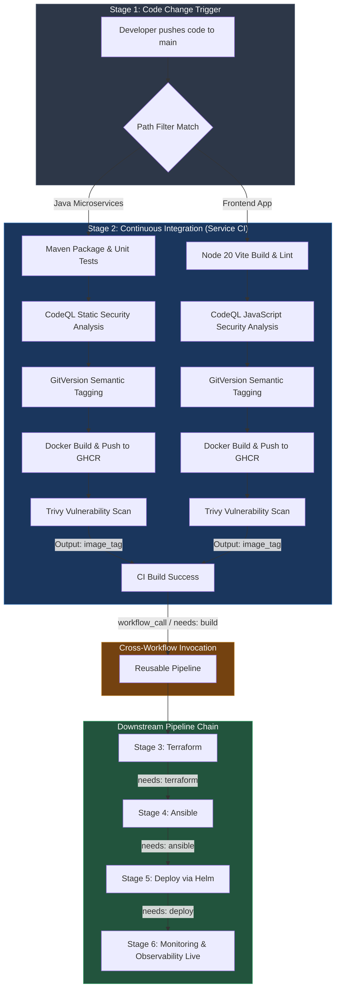
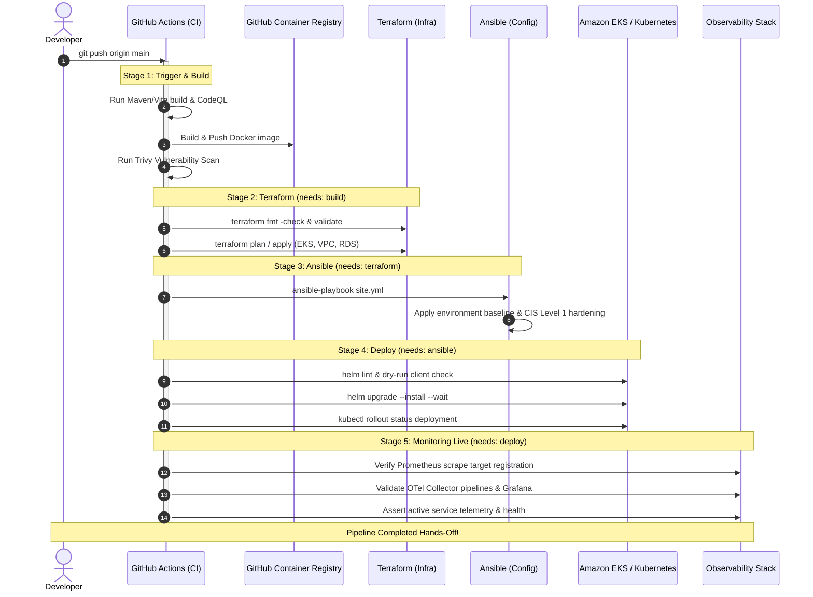

# Automated CI/CD Pipeline Triggers & Architecture

**Ticket:** TITANOPS-46: Automate GitHub Actions triggers across every pipeline stage  
**Platform:** TitanOps / MediCore HMS Platform  
**Target Environments:** AWS (EKS, RDS, VPC) / Local (Minikube)

---

## 1. Executive Summary

This document details the automated trigger architecture implemented for TitanOps HMS. The pipeline connects every stage of the lifecycle hands-off from a single code push:

$$\text{Code Push} \longrightarrow \text{Build} \longrightarrow \text{Terraform} \longrightarrow \text{Ansible} \longrightarrow \text{Deploy} \longrightarrow \text{Monitoring (Live)}$$

Every downstream stage fires automatically in the correct order with zero manual clicks. If any stage encounters a failure, the pipeline execution is immediately halted via strict dependency graphs (`needs:`) and status assertions, preventing broken artifacts or unstable infrastructure states from propagating.

---

## 2. Trigger Chain Architecture



---

## 3. End-to-End Sequence Diagram



---

## 4. Pipeline Stage Breakdown

### Stage 1: Code Change (Event Trigger)
- **Mechanism:** GitHub Actions `push` event on branch `main` with path filtering (`<service>/**`).
- **Hands-off guarantee:** Fully automated upon git push or PR merge. Also supports `workflow_dispatch` for controlled manual executions.

### Stage 2: Build & Package (`build` / `docker`)
- Compiles source code with Java 11 (Maven) or Node.js 20 (Vite).
- Performs CodeQL static application security testing (SAST).
- Determines semantic versioning via `gittools/actions/gitversion`.
- Builds container images and exports artifact.
- Scans container image for vulnerabilities using Aquasecurity Trivy.
- **Output:** Exports `image_tag` as a workflow step output for deterministic downstream deployment.

### Stage 3: Terraform Infrastructure Validation (`terraform`)
- **Dependency:** Triggered via `workflow_call` upon `build` completion.
- Sets up Terraform (pinned v1.7.5).
- Verifies Terraform syntax formatting across modules: `terraform fmt -check -recursive`.
- Initializes root modules with `-backend=false` for deterministic static analysis.
- Validates module structure, provider schemas, and expressions: `terraform validate`.
- Evaluates target environment planning (`-var env=dev`).
- If AWS OIDC credentials are provided (`vars.AWS_OIDC_ROLE_ARN`), executes live plan and apply against AWS infrastructure.

### Stage 4: Ansible Configuration Management (`ansible`)
- **Dependency:** `needs: [terraform]`
- Sets up Python 3.11 and installs Ansible.
- Verifies playbook syntax: `ansible-playbook --syntax-check ansible/playbooks/site.yml`.
- Executes Ansible playbook `ansible/playbooks/site.yml` with `inventory/hosts.ini`:
  - Validates environment baseline and prerequisite cluster tooling.
  - Ensures Kubernetes namespace (`hms`) and metadata/labels are configured.
  - Enforces CIS Benchmark (Level 1) baseline hardening constraints (non-root execution, privilege escalation denial).
  - Confirms cluster readiness for application deployment.

### Stage 5: Deploy via Helm (`deploy`)
- **Dependency:** `needs: [ansible]`
- Sets up `kubectl` (v1.29.0) and `helm` (v3.14.0).
- Resolves configuration values hierarchy (`helm/values/<service>.yaml` and environment overrides).
- Performs Helm linting and client dry-run upgrade/install.
- Verifies rendered Kubernetes Deployment and Service manifests.
- If live cluster connection is configured, executes live `helm upgrade --install` with `--wait --timeout 5m` and validates rollout status via `kubectl rollout status`.

### Stage 6: Monitoring & Telemetry Live (`monitoring`)
- **Dependency:** `needs: [deploy]`
- Confirms monitoring is already live and actively collecting telemetry:
  - Validates Prometheus scrape configuration (`prometheus.yml`).
  - Validates OpenTelemetry Collector receiver/exporter pipelines (`otel-collector-config.yaml`).
  - Validates Grafana dashboard JSON models (`grafana/dashboards/*.json`).
  - Asserts microservice telemetry and health integration.

---

## 5. Failure Handling & Stop-the-Line Behavior

To satisfy the requirement that failure in any stage stops the chain rather than silently continuing:

1. **Strict Dependency Graph (`needs:`):**
   ```yaml
   terraform:
     # Runs first in reusable workflow
   ansible:
     needs: [terraform]
   deploy:
     needs: [ansible]
   monitoring:
     needs: [deploy]
   ```
   By default in GitHub Actions, a job with `needs: [dependency]` will **only** execute if all dependencies evaluate to `success`. If `build`, `terraform`, `ansible`, or `deploy` fails, all downstream stages are immediately marked as `skipped` / `cancelled`.

2. **Conditional Status Guards:**
   - Where explicit checks are needed, `${{ needs.<job>.result == 'success' }}` or `${{ github.event.workflow_run.conclusion == 'success' }}` enforces strict stop-on-error behavior.
   - Scripts utilize `set -euo pipefail` so any command failure immediately exits with non-zero exit codes.

---

## 6. Verification Against Acceptance Criteria

| Requirement | Implementation | Status |
| :--- | :--- | :--- |
| **Pipeline Order:** `code change -> build -> Terraform -> Ansible -> deploy -> (monitoring already live)` | Sequenced in service CI and reusable workflows | **PASSED** |
| **Hands-off Execution:** No stage needing a manual click | Fully automated via `push`, `workflow_call`, `needs:` | **PASSED** |
| **Failure Halting:** Any stage failure immediately stops downstream chain | Guarded by `needs: [...]` without permissive `always()` overrides | **PASSED** |
| **Cross-workflow Triggers:** `workflow_call` / `workflow_run` | `reusable-ecr-push.yml`, `reusable-pipeline.yml`, and `e2e-pipeline-orchestrator.yml` | **PASSED** |
| **Diagrammed & Documented:** Complete architecture and sequence diagrams | Documented in `PIPELINE-TRIGGERS.md` with Mermaid diagrams | **PASSED** |
