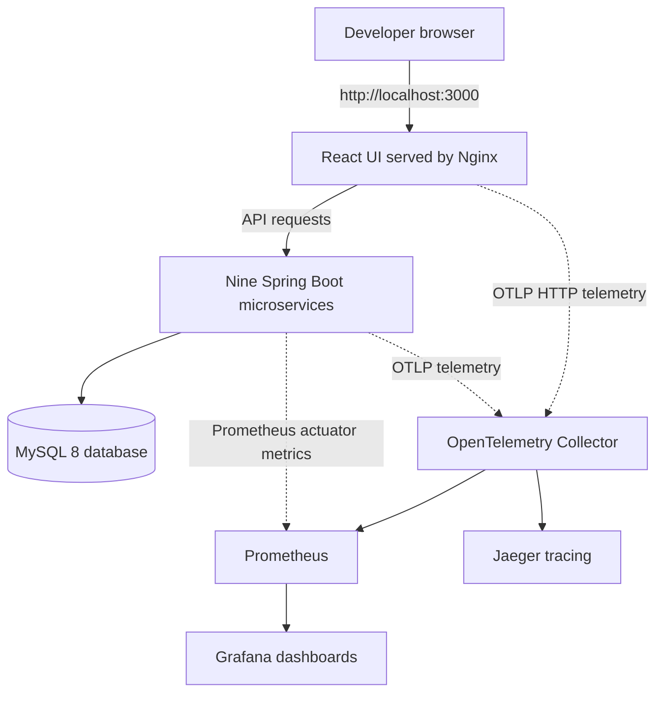
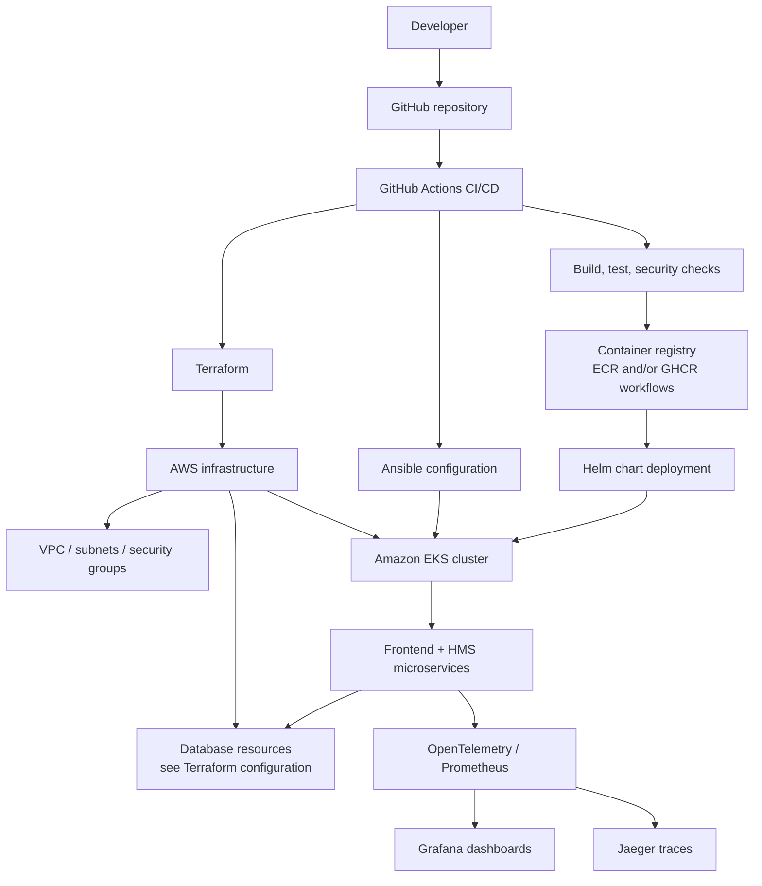
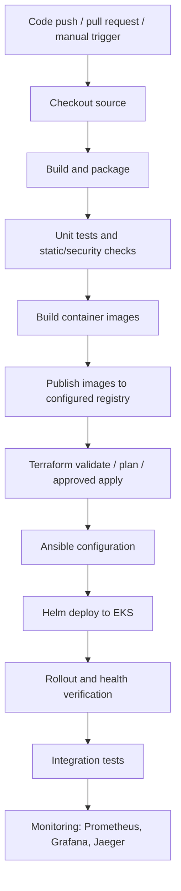

# TitanOps HMS — End-to-End DevOps CI/CD Project

> **Capstone Project 4:** End-to-End DevOps Pipeline for a Web Application with CI/CD  
> **Application:** MediCore HMS (Hospital Management System)  
> **Repository:** `titanops-hms-core`  
> **Purpose:** Explain the application, architecture, local execution, CI/CD flow, deployment components, testing, monitoring, and troubleshooting in one place.

---

## 1. Project overview

TitanOps HMS is a containerized, microservices-based Hospital Management System (HMS) with a React web frontend and nine Spring Boot backend services. The repository includes local Docker Compose configuration and DevOps assets for infrastructure provisioning, configuration management, Kubernetes deployment, CI/CD, security scanning, and observability.

The project is intended to demonstrate this delivery lifecycle:

1. A developer changes application or infrastructure code and pushes it to GitHub.
2. GitHub Actions validates and builds the code.
3. Container images are built and published to a container registry.
4. Terraform provisions or updates AWS infrastructure.
5. Ansible performs configuration tasks.
6. Helm deploys the application to Kubernetes on Amazon EKS.
7. Health checks, integration tests, metrics, logs, and traces help verify the deployment.

**Important:** The repository contains configuration and automation for these stages. A workflow file existing in GitHub does not, by itself, prove that a live deployment has succeeded. Configure the required GitHub environments/secrets, AWS IAM/OIDC permissions, registry, cluster, and application settings, then verify actual run results.

## 2. Architecture at a glance

### 2.1 Local development architecture

This is the local Docker Compose view described by `LOCAL-SANDBOX-SETUP.md` and `docker-compose.yml`.



### 2.2 Microservices

| Service | Default local port | Purpose indicated by service name |
|---|---:|---|
| Patient Service | 8081 | Patient APIs |
| Appointment Service | 8082 | Appointment APIs |
| User Service | 8083 | User APIs |
| Billing Service | 8084 | Invoice/billing APIs |
| Encounter Service | 8085 | Encounter APIs |
| Lab Service | 8086 | Lab order APIs |
| Medication Service | 8087 | Medication APIs |
| Prescription Service | 8088 | Prescription APIs |
| Provider Service | 8089 | Provider APIs |

The local Compose stack also includes:

| Component | Local port | Role |
|---|---:|---|
| MediCore HMS UI | 3000 | Browser-based frontend |
| MySQL | 3306 | Relational database |
| Grafana | 3001 | Dashboards |
| Prometheus | 9090 | Metrics collection/query |
| Jaeger UI | 16686 | Distributed tracing UI |
| OpenTelemetry Collector | 4317 / 4318 | OTLP gRPC / HTTP ingestion |

Ports are based on the checked-in local setup guide and Compose configuration. Confirm actual published ports with `docker compose ps`.

### 2.3 AWS / Kubernetes deployment architecture

The repository includes Terraform, Ansible, Kubernetes/Helm, registry, and monitoring assets. The following is the intended high-level deployment relationship; exact AWS resources and workflow activation depend on the selected Terraform root, Helm values, and configured GitHub environment.



### 2.4 CI/CD flow



**Workflow note:** `.github/workflows/` contains multiple service-specific and infrastructure workflows as well as orchestration/reusable workflows. Read the trigger and job dependencies in the actual workflow before assuming every push runs every stage. Review the workflow run in GitHub Actions to confirm which stages executed.

---

## 3. Repository map

| Path | What it contains |
|---|---|
| `frontend/` | React/Vite frontend, Nginx configuration, frontend Dockerfile |
| `patient-service/` | Patient Spring Boot microservice |
| `appointment-service/` | Appointment Spring Boot microservice |
| `user-service/` | User Spring Boot microservice |
| `billing-service/` | Billing Spring Boot microservice |
| `encounter-service/` | Encounter Spring Boot microservice |
| `lab-service/` | Lab Spring Boot microservice |
| `medication-service/` | Medication Spring Boot microservice |
| `prescription-service/` | Prescription Spring Boot microservice |
| `provider-service/` | Provider Spring Boot microservice |
| `docker-compose.yml` | Local multi-container application definition |
| `.env.example` | Example environment configuration |
| `.github/workflows/` | GitHub Actions workflows |
| `terraform/` | Root Terraform configuration and modules |
| `infra/` | Additional infrastructure configuration and documentation |
| `ansible/` | Ansible configuration and playbooks |
| `k8s/` | Kubernetes resources, including service-account configuration |
| `helm/` | Helm chart and environment values |
| `prometheus.yml` | Prometheus scrape configuration |
| `otel-collector-config.yaml` | OpenTelemetry Collector configuration |
| `grafana/` | Grafana dashboards and provisioning assets |
| `integration-tests/` | Post-deployment integration test scripts |
| `scripts/` | Validation and feature-specific test scripts |
| `docs/` | Detailed implementation and operations documents |
| `Diagrams/` | Existing AWS architecture diagram assets |
| `AWS-Architecture-Design-Document.md` | AWS architecture design document |
| `HIGH-LEVEL-DESIGN.md` | High-level system design |
| `LOW-LEVEL-DESIGN.md` | Detailed component design |
| `LOCAL-SANDBOX-SETUP.md` | Existing local sandbox guide |
| `PIPELINE-TRIGGERS.md` | Pipeline trigger and sequence documentation |

---

## 4. Prerequisites for local execution

The repository's local sandbox guide lists Docker Engine/Desktop, Docker Compose, Git, PowerShell on Windows or Bash on macOS/Linux, and Node.js for integration tests. Maven wrappers are included in the Java service folders.

Recommended workstation capacity from the local guide:

- 4 CPU cores
- 8 GB RAM available to Docker
- Approximately 6 GB disk space for images, database volume, and build dependencies

Check installed tools:

**Windows PowerShell**
```powershell
docker --version
docker compose version
git --version
java -version
node --version
```

**macOS / Linux**
```bash
docker --version
docker compose version
git --version
java -version
node --version
```

Docker Desktop/Engine must be running. Internet access is needed for image and dependency downloads.

---

## 5. Run locally with Docker Compose

> Run commands from the repository root — the directory containing `docker-compose.yml`. The checked-in `LOCAL-SANDBOX-SETUP.md` also describes a helper-script path under `legacy/java-microservices`; verify that path exists in your checkout before using that helper. The root-level Compose file is the direct local entry point.

### Step 1 — Enter the repository root

```powershell
cd path\to\titanops-hms-core
```

or:

```bash
cd /path/to/titanops-hms-core
```

### Step 2 — Validate Compose configuration

```bash
docker compose config --quiet
```

If this reports an error, resolve the reported configuration or environment-variable issue before starting containers.

### Step 3 — Check backend JARs

The Java service Dockerfiles copy a built JAR from each service's `target/` directory. A fresh source checkout may not contain runnable JARs.

Check on PowerShell:

```powershell
Get-ChildItem patient-service,appointment-service,user-service,billing-service,encounter-service,lab-service,medication-service,prescription-service,provider-service -Recurse -Filter *.jar
```

Check on macOS/Linux:

```bash
find patient-service appointment-service user-service billing-service encounter-service lab-service medication-service prescription-service provider-service -path '*/target/*.jar' -print
```

If the runnable JARs are absent, build the services before building Docker images. Use the Maven wrapper included in each service directory.

**Compatibility check:** inspect each service's `pom.xml` and Dockerfile before building. The supplied repository has different Spring Boot/Java configurations across services, and the local setup guide describes JDK 11. Confirm each Spring Boot version's supported Java range and ensure the build JDK and container runtime are compatible. Do not assume all services can be built with one Java version without checking.

Example for one service:

**PowerShell**
```powershell
cd patient-service
.\mvnw.cmd -B clean package -DskipTests
cd ..
```

**macOS/Linux**
```bash
cd patient-service
chmod +x mvnw
./mvnw -B clean package -DskipTests
cd ..
```

Repeat for the other service folders. The repository also contains `rebuild-all-services.ps1` for Windows; inspect its prompts and actions before running it.

### Step 4 — Start the stack

After required JARs are available:

```bash
docker compose up -d --build
```

This builds images and starts containers. The first run can take several minutes while dependencies and base images download.

### Step 5 — Check container status and logs

```bash
docker compose ps
docker compose ps -a
docker compose logs --tail=100
```

For a specific service:

```bash
docker compose logs --tail=200 patient-service
docker compose logs --tail=200 mysql
docker compose logs --tail=200 medicore-hms-ui
```

### Step 6 — Open local services

| Component | URL |
|---|---|
| HMS frontend | http://localhost:3000 |
| Grafana | http://localhost:3001 |
| Prometheus | http://localhost:9090 |
| Jaeger | http://localhost:16686 |

Grafana credentials are configured through the environment variables used by the Compose setup. Do not assume a default password for a shared or non-local environment.

### Step 7 — Test HTTP endpoints

The repository's local setup guide lists these API paths:

```text
http://localhost:8081/api/patients
http://localhost:8082/api/appointments
http://localhost:8083/api/users
http://localhost:8084/api/invoices
http://localhost:8085/api/encounters
http://localhost:8086/api/labs/orders
http://localhost:8087/api/medications
http://localhost:8088/api/prescriptions
http://localhost:8089/api/providers
```

PowerShell example:

```powershell
Invoke-WebRequest http://localhost:3000/ -UseBasicParsing
Invoke-WebRequest http://localhost:8081/api/patients -UseBasicParsing
```

A `200` response is a common success result. `401`/`403` may mean authentication is required; `404` may mean the route differs from the documented path; connection refused usually means the service is not listening or its container is unhealthy. Check the relevant controller and container logs before concluding that an API is broken.

### Step 8 — Stop local containers

```bash
docker compose down
```

This stops and removes Compose containers and the project network. Named database volumes are retained by default.

**Warning:** `docker compose down -v` deletes named volumes and can remove local database data. Use it only when you intentionally want to reset the local database.

---

## 6. CI/CD: how to validate the existing workflows

GitHub Actions definitions are under `.github/workflows/`. The repository includes workflows for individual services, frontend, Terraform, Ansible, Helm, image publishing, security checks, and pipeline orchestration.

Recommended validation order:

1. Open the repository on GitHub and select **Actions**.
2. Inspect the workflow triggers (`push`, `pull_request`, `workflow_dispatch`, `workflow_call`) and branch/path filters.
3. Start with a feature branch and pull request rather than pushing directly to `main`.
4. Confirm the relevant service/frontend build and test workflows execute.
5. Confirm security and Helm validation jobs execute where applicable.
6. Verify image publishing only after the build succeeds.
7. Verify Terraform plan output before any apply.
8. Deploy only to a non-production environment after AWS credentials and cluster access are verified.
9. Confirm Kubernetes rollout and post-deployment integration tests.
10. Save screenshots/logs of successful runs as project evidence.

### GitHub Actions / AWS configuration to verify

The exact required variable and secret names must be taken from the workflow YAML. Common items referenced by this repository include:

- AWS region
- AWS OIDC role ARN
- EKS cluster name
- Environment-specific configuration
- Registry/repository settings
- GitHub environment protection and approval rules

Prefer GitHub OIDC federation over long-lived AWS access keys when the workflow supports it. Scope the AWS role trust policy to the intended GitHub repository, branch, and environment.

**Do not run a Terraform apply or live deployment until the account, region, state backend, IAM permissions, estimated cost, and approval requirements have been reviewed.**

---

## 7. Infrastructure and deployment components

| Technology | Role in this project |
|---|---|
| Terraform | Defines AWS infrastructure |
| AWS VPC / subnets / security groups | Network foundation |
| Amazon EKS | Kubernetes control plane and workloads |
| Amazon ECR / GHCR workflows | Container image storage and distribution |
| Ansible | Configuration management tasks |
| Kubernetes | Runs application workloads |
| Helm | Packages and deploys Kubernetes resources |
| GitHub Actions | CI/CD workflow automation |
| Trivy / CodeQL / secret scanning workflows | Security and vulnerability checks |
| Prometheus | Metrics collection |
| Grafana | Metrics dashboards |
| OpenTelemetry Collector | Telemetry collection/export |
| Jaeger | Distributed tracing |
| MySQL / configured database resources | Application persistence |

The repository has more than one infrastructure-related directory (`terraform/` and `infra/`). Review the workflow `working-directory` and backend configuration to determine which one a particular pipeline uses. Do not assume both directories represent the same Terraform root or state.

---

## 8. Testing checklist

Use this checklist during local and cloud validation.

| Test area | What to verify | Evidence |
|---|---|---|
| Compose configuration | `docker compose config --quiet` succeeds | Terminal output |
| Backend build | All required Maven builds succeed | Maven logs |
| Frontend build | Frontend build/lint succeeds | npm logs |
| Container startup | Expected containers are running and stable | `docker compose ps` |
| Database | MySQL accepts connections; services connect successfully | MySQL and service logs |
| API smoke tests | Documented routes respond as expected | HTTP status and response |
| Unit tests | Actual test suites pass without ignored failures | Test reports |
| Integration tests | End-to-end tests pass against the intended environment | Integration test artifact |
| Image security | Scanner runs and findings are reviewed | Trivy/CodeQL output |
| Terraform | Format, init, validate, and plan succeed | Plan output |
| Kubernetes | Nodes and pods are Ready | `kubectl get nodes/pods` |
| Helm | Chart lint/render/deploy succeeds | Helm output |
| Monitoring | Prometheus targets are healthy and Grafana has data | Screenshots |
| Tracing | Requests produce traces in Jaeger | Trace screenshot |
| Rollback | A controlled non-production failure exercises rollback | Workflow and Helm history |

A passing configuration check is not equivalent to a successful application test. Record actual outcomes and do not mark a test as passed until it has been run.

---

## 9. Troubleshooting guide

| Symptom | First checks |
|---|---|
| Docker daemon unavailable | Start Docker Desktop; run `docker info` |
| Compose configuration error | Run `docker compose config` and inspect missing variables |
| Docker build cannot find `target/*.jar` | Build the corresponding Java service with its Maven wrapper |
| Spring Boot startup fails | Inspect service logs and compare Spring Boot, JDK, and container runtime versions |
| MySQL connection refused | Check MySQL health, credentials, database URL, and service logs |
| Port already allocated | Identify the process using the port or configure a supported alternate mapping |
| Frontend loads but API calls fail | Inspect Nginx proxy configuration, browser network errors, and backend service status |
| EKS deployment cannot authenticate | Check GitHub OIDC trust, AWS role, region, cluster name, and Kubernetes access |
| Pods show `ImagePullBackOff` | Check image URI/tag, registry permissions, and image architecture |
| Helm deployment times out | Inspect `kubectl get pods`, `kubectl describe`, and pod logs |
| Grafana has no data | Check Prometheus targets, scrape configuration, and data source |
| Jaeger has no traces | Check OTEL SDK/exporter settings and collector receiver/exporter logs |

Useful commands:

```bash
docker compose ps -a
docker compose logs --tail=200
docker compose config
```

For Kubernetes:

```bash
kubectl get nodes
kubectl get pods --all-namespaces
kubectl get events -A --sort-by=.lastTimestamp
```

---

## 10. Cost and security precautions

- Use a dedicated development AWS account or approved sandbox.
- Review Terraform plan and estimated costs before provisioning.
- EKS, EC2 worker nodes, NAT gateways, load balancers, and managed databases may incur ongoing charges.
- Restrict Kubernetes API access; do not expose it to `0.0.0.0/0`.
- Do not commit `.env`, passwords, access keys, Terraform state, or private certificates.
- Use least-privilege IAM and short-lived OIDC credentials where supported.
- Use non-production data for demonstrations.
- After testing, destroy only the resources created for this project and verify that no billable resources remain. Preserve required state, backups, and evidence before cleanup.

---

## 11. Existing project documentation

The repository already contains deeper documents. Read these for implementation detail:

- `LOCAL-SANDBOX-SETUP.md` — local setup and ports
- `HIGH-LEVEL-DESIGN.md` — system overview
- `LOW-LEVEL-DESIGN.md` — component-level design
- `AWS-Architecture-Design-Document.md` — AWS design
- `PIPELINE-TRIGGERS.md` — pipeline trigger and sequence diagrams
- `docs/SETUP-AND-TROUBLESHOOTING-GUIDE.md` — operational guidance
- `docs/FINAL-E2E-PIPELINE-REPORT.md` — pipeline report
- `docs/PRODUCTION-READINESS-REVIEW.md` — production-readiness review
- `ansible/README.md`, `infra/README.md`, `grafana/README.md` — component-specific guidance

The `Diagrams/` folder also contains an existing Draw.io AWS architecture diagram and exported image files.

---

## 12. Capstone demonstration sequence

For a clear evaluator demonstration:

1. Explain the business/application architecture and nine microservices.
2. Open the local application and demonstrate a working user flow.
3. Show a code change and pull request.
4. Show the GitHub Actions build, test, and security results.
5. Show the built image and its registry tag.
6. Show Terraform plan and explain the AWS network/compute resources.
7. Show Ansible configuration tasks.
8. Show the EKS cluster, Kubernetes workloads, and Helm release.
9. Demonstrate API/rollout verification and integration test results.
10. Show Prometheus targets, Grafana dashboards, and Jaeger traces.
11. Explain security controls, rollback approach, and cost cleanup.

### Project completion evidence

Capture real screenshots or logs for each stage. Clearly label anything that is a local simulation, static validation, or planned cloud deployment; do not present a dry-run as a live deployment.

---

**Document note:** This README is a navigation and explanation guide based on the uploaded project archive and its accompanying capstone brief. It does not claim that the project was executed or that all pipelines/cloud resources have been independently verified.
