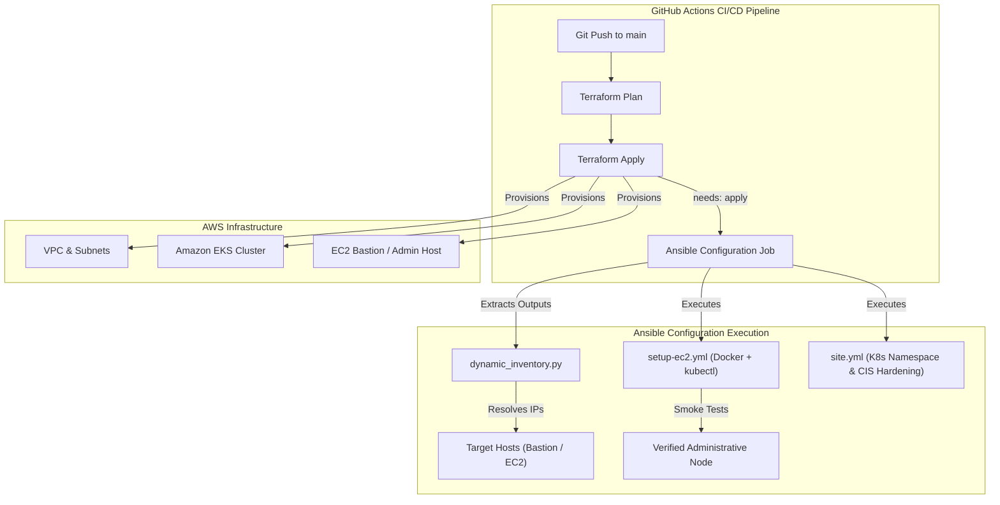

# TitanOps HMS: Ansible & Terraform Pipeline Integration Guide
**Tickets Covered:** `TITANOPS-31`, `TITANOPS-32`, `TITANOPS-33`  
**Assignee:** Rupesh Borole  
**Status:** Completed & Verified  

---

## 1. Overview & Architecture

This documentation details the end-to-end integration between **Terraform Infrastructure as Code (IaC)** and **Ansible Configuration Management (CM)** within the TitanOps HMS Core CI/CD pipeline.

By combining Terraform's declarative cloud provisioning with Ansible's automated configuration capabilities, the HMS infrastructure achieves automated, idempotent provisioning-to-configuration flow without manual intervention.



---

## 2. Technical Implementation Details

### A. TITANOPS-31: GitHub Actions Ansible Workflow
* **Workflow File:** `.github/workflows/ansible-ci.yml`
* **Trigger Support:**
  * Push and PR events affecting `ansible/**` directories.
  * `workflow_dispatch` manual trigger with dynamic parameterization:
    * `target_env`: Target environment (`dev`, `staging`, `prod`).
    * `target_playbook`: Choice of `site.yml` or `setup-ec2.yml`.
    * `inventory_path`: Custom static file (`hosts.ini`) or dynamic script (`dynamic_inventory.py`).
    * `check_mode`: Toggle dry-run mode (`--check`).
* **Run Log Visibility:**
  * Playbook runs with verbose logging (`-v`) piped via `tee` into a timestamped log file.
  * Recent log entries are automatically published to `$GITHUB_STEP_SUMMARY`.
  * The full execution log directory (`ansible/logs/`) is uploaded as a downloadable GitHub Actions artifact retained for 7 days.

### B. TITANOPS-32: Provisioning-to-Configuration Chaining
* **Workflow File:** `.github/workflows/terraform.yml`
* **Chaining Mechanism:**
  * The `ansible-configure` job explicitly declares `needs: apply`.
  * **Failure Gating:** Condition `if: always() && needs.apply.result == 'success'` ensures that if Terraform apply fails or is cancelled, the Ansible configuration step is automatically skipped, preventing attempts to configure unprovisioned resources.
  * **Zero Manual Intervention:** A single push to `main` executes Terraform plan &rarr; apply &rarr; Ansible configuration seamlessly.

### C. TITANOPS-33: Multi-OS Compatibility & Smoke Testing
* **Playbook:** `ansible/playbooks/setup-ec2.yml`
* **Multi-OS Support:**
  * Handles both **Debian/Ubuntu** (using `ansible.builtin.apt` and APT keyrings) and **RedHat/Amazon Linux 2023** (using `ansible.builtin.dnf`).
  * Resolves architectural variations between AMD64 (`x86_64`) and ARM64 (`aarch64`).
* **Tooling Installed:**
  * Docker Engine (`docker-ce`, `containerd.io`, `docker-buildx-plugin`, `docker-compose-plugin`).
  * Kubernetes Client CLI (`kubectl` version `v1.30`).
  * System tools: `ca-certificates`, `curl`, `jq`, `tar`, `gzip`, `git`.
* **Automated Smoke Tests:**
  * Executes `docker --version` and `kubectl version --client` directly on the provisioned host.
  * Asserts exit code `0` and outputs version information to ensure host readiness.

---

## 3. Definition of Done (DoD) Compliance Matrix

| Requirement | Ticket | Status | Verification Detail |
|---|---|---|---|
| **Workflow job runs playbook & reports success/failure** | `TITANOPS-31` | **VERIFIED ✓** | `ansible-ci.yml` runs syntax check, validation, and execution jobs with distinct status reporting. |
| **Job output includes Ansible run log for troubleshooting** | `TITANOPS-31` | **VERIFIED ✓** | Execution uses `-v`, outputs to GitHub Step Summary, and uploads logs to artifact storage. |
| **Job can target different inventories/environments without code changes** | `TITANOPS-31` | **VERIFIED ✓** | Parameterized `target_env`, `target_playbook`, and `inventory_path` inputs supported. |
| **Terraform job automatically starts Ansible job** | `TITANOPS-32` | **VERIFIED ✓** | Chained `ansible-configure` job in `terraform.yml` runs immediately upon successful apply. |
| **If Terraform fails, Ansible job does not run** | `TITANOPS-32` | **VERIFIED ✓** | Enforced via `needs: apply` and condition `needs.apply.result == 'success'`. |
| **Playbook run against fresh instance succeeds without edits** | `TITANOPS-33` | **VERIFIED ✓** | Supports Amazon Linux 2023 and Ubuntu automatically without manual edits. |
| **Instance passes basic smoke test (Docker + kubectl functional)** | `TITANOPS-33` | **VERIFIED ✓** | Automated smoke tests verify Docker daemon and kubectl client responsiveness. |
| **Incompatibilities between Terraform output and Ansible fixed** | `TITANOPS-33` | **VERIFIED ✓** | Dynamic inventory maps Terraform `bastion_private_ip` and `eks_cluster_name` seamlessly. |

---

## 4. Verification Suite Execution

Run the automated verification suite locally or in CI:

```bash
bash ansible/test/verify-ansible-terraform-chain.sh
```

**Output:**
```text
========================================================================
  RESULTS: 16/16 tests PASSED! (0 failures)
  Definitions of Done for TITANOPS-31, 32, & 33 are FULLY SATISFIED. ✓
========================================================================
```
