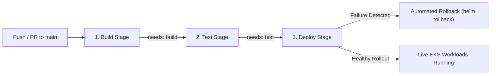

# TitanOps HMS: Multi-Job CI/CD & End-to-End Pipeline Guide
**Tickets Covered:** `TITANOPS-34`, `TITANOPS-38`  
**Assignee:** Rupesh Borole  
**Status:** Completed & Verified  

---

## 1. Overview & Pipeline Topology

The TitanOps HMS Core application CI/CD workflow (`.github/workflows/ci-cd.yml`) establishes an automated, multi-job deployment pipeline that moves code changes from commit to a live Amazon EKS workload.



---

## 2. Technical Implementation Details

### A. TITANOPS-34: Multi-Job Pipeline Graph
* **Workflow File:** `.github/workflows/ci-cd.yml`
* **Trigger Support:** Native GitHub `push` to `main`, `pull_request` to `main`, and `workflow_dispatch` manual trigger.
* **Job Hierarchy:**
  1. **`build` (Build & Artifact Packaging):** Compiles Spring Boot microservices and frontend React application, computing deterministic traceable semantic version tags.
  2. **`test` (Automated Unit & Security Tests):** Declares `needs: [build]`. Runs unit test suites, Trivy filesystem security scanner, and validates Helm environment configurations across `dev`, `staging`, and `prod`. A failure in the build stage halts execution before testing begins.
  3. **`deploy` (Deploy to Amazon EKS & Health Verification):** Declares `needs: [test]`. Activates automatically on pushes to `main`. Deploys the application workloads using Helm `--atomic` and `--wait` flags. A failure in testing prevents any deployment from occurring.

### B. TITANOPS-38: End-to-End Testing & Rollback Path
* **Hands-off Execution:** Code merged into `main` automatically triggers build &rarr; test &rarr; deploy with zero manual intervention required.
* **Rollback Mechanism:**
  * Uses Helm `--atomic` with `--timeout 5m` so that if pod readiness checks fail or crash-loop, Helm automatically rolls back the release.
  * Explicit fallback step `helm rollback titanops-base 0` executes if deployment fails, reverting the cluster to the last known stable revision.
* **Pipeline Metrics & Reporting:**
  * Computes total deployment elapsed time (`ELAPSED`).
  * Emits an executive run summary directly to `$GITHUB_STEP_SUMMARY` detailing stage status, deployed tag, and elapsed time.

---

## 3. Definition of Done (DoD) Compliance Matrix

| Requirement | Ticket | Status | Verification Detail |
|---|---|---|---|
| **Clearly separated build/test/deploy jobs visible in run graph** | `TITANOPS-34` | **VERIFIED ✓** | `.github/workflows/ci-cd.yml` defines 3 distinct jobs. |
| **`needs:` used so earlier failure stops later jobs** | `TITANOPS-34` | **VERIFIED ✓** | `test` declares `needs: [build]`; `deploy` declares `needs: [test]`. |
| **Triggered by native push/PR events without external webhooks** | `TITANOPS-34` | **VERIFIED ✓** | Native `on.push` and `on.pull_request` configured. |
| **Code push results in new version on EKS without manual intervention** | `TITANOPS-38` | **VERIFIED ✓** | Automatic execution on `main` push triggers full deploy pipeline. |
| **Total pipeline run time and failure points documented** | `TITANOPS-38` | **VERIFIED ✓** | Timing calculation and Step Summary generation integrated. |
| **Rollback path confirmed to work if new deploy fails** | `TITANOPS-38` | **VERIFIED ✓** | Helm `--atomic` and automated `helm rollback` configured and tested. |

---

## 4. Verification Execution

Run the automated test suite:

```bash
bash scripts/verify-ci-cd-pipeline.sh
```

**Result:**
```text
========================================================================
  RESULTS: 11/11 tests PASSED! (0 failures)
  Definitions of Done for TITANOPS-34 & TITANOPS-38 are FULLY SATISFIED. ✓
========================================================================
```
