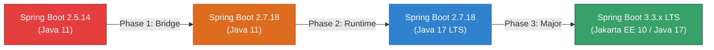

# Technical Debt & Upgrade Roadmap: Spring Boot 2.5.14 to 3.x LTS

**Platform:** TitanOps / MediCore HMS Platform  
**Target Services:** All 9 Java Spring Boot Microservices  
- `appointment-service`
- `billing-service`
- `encounter-service`
- `lab-service`
- `medication-service`
- `patient-service`
- `prescription-service`
- `provider-service`
- `user-service`

**Status:** Tracked Follow-up Item (Task: Add Dependency / SCA Vulnerability Scanning to CI)  
**Priority:** High  
**Current Baseline:** Spring Boot 2.5.14 / Java 11  
**Target Baseline:** Spring Boot 3.3.x (or 3.2.x) LTS / Java 17 LTS (or Java 21 LTS)

---

## 1. Executive Summary & Problem Statement

All backend microservices in the TitanOps HMS suite are currently built using **Spring Boot 2.5.14** on **Java 11**. 

### Critical EOL & Security Context
- **End-of-Life (EOL):** Open-source support for the Spring Boot 2.5.x generation concluded on **May 19, 2022**, and commercial extended support ended in **August 2023**.
- **Security Exposure:** Running on an EOL framework leaves the application exposed to known Common Vulnerabilities and Exposures (CVEs) in core transitives, including:
  - **Spring Framework 5.3.x**
  - **Embedded Apache Tomcat 9.0.x** (HTTP request smuggling, denial of service)
  - **SnakeYAML & Jackson Core** (Remote Code Execution and deserialization vulnerabilities)
  - **Logback & SLF4J**
- **SCA Finding:** Automated Software Composition Analysis (SCA) scans flag Spring Boot 2.5.14 as obsolete with High/Critical transitive CVEs that cannot be patched without upgrading the parent framework.

---

## 2. Target Architecture

| Component | Current State | Target State | Notes |
| :--- | :--- | :--- | :--- |
| **Spring Boot** | `2.5.14` (EOL) | `3.3.x` LTS | Active OSS support with latest CVE patches |
| **Java / JDK** | `11` (Temurin) | `17` LTS (or `21` LTS) | Java 17 is the minimum baseline for Spring Boot 3 |
| **Java EE API** | `javax.*` | `jakarta.*` | Jakarta EE 10 baseline requirement |
| **MySQL Driver** | `mysql:mysql-connector-java` | `com.mysql:mysql-connector-j` | Modern MySQL 8.x JDBC driver |
| **OpenTelemetry**| `1.33.6-alpha` | Modern 2.x OpenTelemetry instrumentation | Official Spring Boot 3 Actuator integration |
| **Base Docker Image** | `eclipse-temurin:11-jre-focal` | `eclipse-temurin:17-jre-alpine` or `focal` | Leaner, secure container baseline |

---

## 3. Phased Migration Roadmap

Migrating directly from Spring Boot 2.5.14 to 3.x is high risk due to major breaking changes (Jakarta EE namespace shift and Spring Security redesign). The recommended approach is a structured **3-phase migration**:



---

### Phase 1: Step-Stone Bridge to Spring Boot 2.7.18
**Goal:** Reach the final release of Spring Boot 2.x while remaining on Java 11.

1. **Update `pom.xml` Parent:**
   ```xml
   <parent>
       <groupId>org.springframework.boot</groupId>
       <artifactId>spring-boot-starter-parent</artifactId>
       <version>2.7.18</version>
       <relativePath/>
   </parent>
   ```
2. **Review Spring 2.6 / 2.7 Deprecations:**
   - Circular reference prohibition (disabled by default in 2.6+ via `spring.main.allow-circular-references: false`).
   - `spring.config.import` syntax for configuration profiles.
   - Run `./mvnw clean test` across all 9 services.

---

### Phase 2: JDK Upgrade from Java 11 to Java 17 LTS
**Goal:** Upgrade project build and container runtimes to Java 17 LTS.

1. **Update `pom.xml` Properties:**
   ```xml
   <properties>
       <java.version>17</java.version>
   </properties>
   ```
2. **Update CI Pipelines (`.github/workflows/*-service-ci.yml`):**
   ```yaml
   - name: Set up JDK 17
     uses: actions/setup-java@v4
     with:
       java-version: '17'
       distribution: 'temurin'
   ```
3. **Update Dockerfiles:**
   ```dockerfile
   FROM eclipse-temurin:17-jre-focal
   ```
4. **Verify Build & Test Suite:**
   Ensure all Maven compiler plugins and bytecode generators build cleanly under JDK 17.

---

### Phase 3: Major Upgrade to Spring Boot 3.x LTS
**Goal:** Complete migration to Spring Boot 3.3.x with Jakarta EE 10.

1. **Update `pom.xml` Parent:**
   ```xml
   <parent>
       <groupId>org.springframework.boot</groupId>
       <artifactId>spring-boot-starter-parent</artifactId>
       <version>3.3.4</version>
   </parent>
   ```

2. **Jakarta EE Namespace Migration (`javax.*` -> `jakarta.*`):**
   - JPA Annotations: Replace `javax.persistence.*` with `jakarta.persistence.*`.
   - Servlet API: Replace `javax.servlet.*` with `jakarta.servlet.*`.
   - Bean Validation: Replace `javax.validation.*` with `jakarta.validation.*`.

3. **MySQL Driver Dependency Update:**
   ```xml
   <!-- Old (Deprecated) -->
   <!--
   <dependency>
       <groupId>mysql</groupId>
       <artifactId>mysql-connector-java</artifactId>
   </dependency>
   -->
   <!-- New -->
   <dependency>
       <groupId>com.mysql</groupId>
       <artifactId>mysql-connector-j</artifactId>
       <scope>runtime</scope>
   </dependency>
   ```

4. **Spring Security 6 Configuration:**
   - Remove deprecated `WebSecurityConfigurerAdapter`.
   - Replace with modern `SecurityFilterChain` bean definitions.

5. **OpenTelemetry Starter Alignment:**
   - Align OpenTelemetry instrumentation with Spring Boot 3 Actuator Micrometer Tracing (`io.micrometer:micrometer-tracing-bridge-otel`).

---

## 4. Verification and Testing Checklist

- [ ] **Unit Tests:** Execute `./mvnw clean test` across all 9 microservices.
- [ ] **Integration Tests:** Run `./integration-tests/run-tests.sh` to validate HTTP endpoints, JPA persistence, and cross-service orchestration.
- [ ] **Dependency / SCA Scan:** Run Trivy and Dependabot scans to confirm elimination of CVEs.
- [ ] **Observability Smoke Test:** Verify `/actuator/health` and `/actuator/prometheus` metrics scrape cleanly into Prometheus and Grafana.
- [ ] **Canary Rollout:** Deploy to `dev` environment via Helm release and monitor pod health.

---

## 5. Tracked Follow-up Tasks

| Subtask ID | Description | Affected Services | Target Milestone |
| :--- | :--- | :--- | :--- |
| **UPGRADE-01** | Upgrade Maven parent to Spring Boot 2.7.18 | All 9 services | Sprint 1 |
| **UPGRADE-02** | Upgrade CI/CD and Dockerfiles to Java 17 LTS | All 9 services | Sprint 1 |
| **UPGRADE-03** | Jakarta EE package rename (`javax.*` -> `jakarta.*`) | All 9 services | Sprint 2 |
| **UPGRADE-04** | Update MySQL Driver & Spring Security 6 Beans | `user-service`, `patient-service` | Sprint 2 |
| **UPGRADE-05** | Final Spring Boot 3.3.x release validation & merge | All 9 services | Sprint 3 |
